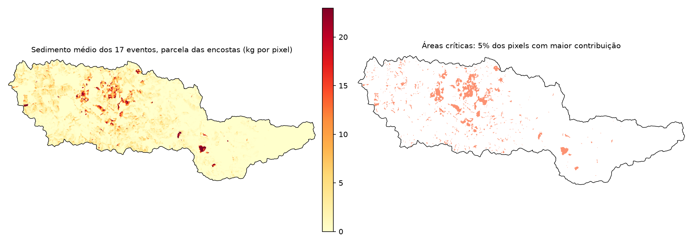

# Espacialização da Equação Universal Modificada de Perda de Solo (MUSLE) para Identificação de Áreas Críticas de Erosão: Estudo de Caso na Bacia do Rio Jundiaí

**Autor:** Mateus Vivarelli
**Orientador:** [PREENCHER]
**Rascunho 02 — 15/10/2026**

> **Como ler este rascunho.** Trechos marcados com **[PENDENTE: ...]** dependem de uma decisão com o orientador, de uma conferência em andamento ou de um dado que falta. Referências marcadas com **[conferir]** não estão nos PDFs do projeto e precisam ter os dados bibliográficos checados antes da entrega. Os números vêm de `Notas Claude/` (seções 15 a 22) e de `Comparacao_Modelos_TCC.xlsx`; os scripts de cada resultado estão em `Scripts/`.

---

## RESUMO

A Equação Universal Modificada de Perda de Solo (MUSLE) estima a produção de sedimentos de eventos de chuva, mas, em sua forma concentrada, trata a bacia como uma unidade homogênea e não mostra onde a erosão se origina. Este trabalho espacializa a MUSLE em pixels de 30 m na parte alta da bacia do rio Jundiaí (137,8 km², São Paulo), para 17 eventos monitorados entre 2018 e 2020. O escoamento direto foi calculado pelo método SCS-CN sobre chuva interpolada de dois postos, a erosão local seguiu Hao et al. (2022) e a vazão de base, que compõe parte da carga medida no exutório, entrou como um termo separado da bacia. Os parâmetros foram calibrados em escala logarítmica e validados por *leave-one-out*. Mostra-se que o volume e o sedimento medidos incluem a vazão de base, que o SCS-CN não representa. Com apenas chuva e vazão inicial como entrada, o modelo acertou 71% dos eventos dentro de fator 2 (erro mediano de 33%), desempenho equivalente ao de uma regra simples com a chuva do evento. Com a água forçada ao valor medido (escoamento direto e vazão de base), o acerto sobe a 94% dos eventos e o erro mediano cai a 12%, equivalente à formulação concentrada da Iniciação Científica, que usa volume e pico medidos. O gargalo está, portanto, em transformar chuva em escoamento. A espacialização mantém a qualidade e acrescenta o mapa de áreas críticas.

**Palavras-chave:** MUSLE; produção de sedimentos; SCS-CN; modelagem distribuída; SIG; bacia do rio Jundiaí.

## ABSTRACT

The Modified Universal Soil Loss Equation (MUSLE) estimates event-scale sediment yield, but in its lumped form it treats the basin as a homogeneous unit and does not show where erosion originates. This work spatializes the MUSLE at a 30 m pixel scale in the upper Jundiaí River basin (137.8 km², São Paulo, Brazil) for 17 rainfall events monitored between 2018 and 2020. Direct runoff was computed with the SCS-CN method over rainfall interpolated from two gauges, local erosion followed Hao et al. (2022), and baseflow, which makes up part of the load measured at the outlet, entered as a separate basin-scale term. Parameters were calibrated on a logarithmic scale and validated by leave-one-out cross-validation. The measured volume and sediment load are shown to include baseflow, which the SCS-CN does not represent. With only rainfall and initial flow as inputs, the model placed 71% of the events within a factor of 2 (median error of 33%), equivalent to a simple rule based on event rainfall. With the water forced to measured values (direct runoff and baseflow) the hit rate rises to 94% and the median error drops to 12%, equivalent to the lumped formulation of the previous undergraduate research project, which uses measured volume and peak discharge. The bottleneck is therefore converting rainfall into runoff. Spatialization keeps the quality and adds the map of critical areas.

**Keywords:** MUSLE; sediment yield; SCS-CN; distributed modelling; GIS; Jundiaí River basin.

---

## 1. INTRODUÇÃO

### 1.1 Contexto

O transporte de sedimentos fluviais é um problema ambiental, social e econômico: afeta a gestão dos recursos hídricos, a qualidade da água e a vida útil de reservatórios. A bacia hidrográfica do rio Jundiaí, no estado de São Paulo, reúne áreas de grande concentração urbana e atividades agrícolas intensivas, o que a torna vulnerável a processos erosivos e ao aumento da carga de sedimentos nos cursos d'água.

Em uma Iniciação Científica anterior (VIVARELLI et al., 2025), a produção de sedimentos na bacia foi quantificada com a Equação Modificada de Perda de Solo (MUSLE; WILLIAMS, 1975), que estima a produção de sedimentos por evento. Essa aplicação foi **concentrada**: as características topográficas, de solo e de uso foram resumidas em valores médios para toda a bacia, e o volume e a vazão de pico foram obtidos do hidrograma medido. A simplificação permite validar o modelo no exutório, mas impede identificar as áreas que mais geram sedimento e representar a heterogeneidade local.

### 1.2 Problema e justificativa

Passar de uma pesquisa de calibração técnica para um estudo útil à gestão da bacia exige resultados distribuídos no espaço. Coletar novos dados de vazão de sedimentos é difícil e caro, porque depende da coincidência entre eventos de chuva significativos e visitas a campo; dividir a bacia em seções com novos postos de medição é inviável no prazo de um TCC.

A premissa deste trabalho é aproveitar a base de dados já levantada, de escoamento e de descarga sólida em suspensão em 17 eventos, e substituir o modelo concentrado por um modelo **espacializado**, em células. Assim é possível, ao mesmo tempo, verificar o modelo em escala de bacia, mapear onde a erosão é gerada em cada evento e identificar o que limita a qualidade das estimativas.

### 1.3 Objetivos

**Objetivo geral.** Desenvolver e aplicar a espacialização da MUSLE em ambiente de Sistemas de Informação Geográfica (SIG) para identificar áreas críticas de erosão na parte alta da bacia do rio Jundiaí e avaliar o que limita a qualidade das estimativas.

**Objetivos específicos.**

1. Espacializar o escoamento superficial de cada um dos 17 eventos pelo método SCS-CN e calcular a vazão de pico local (pr) por pixel, segundo Hao et al. (2022);
2. Mapear, em formato raster, os fatores físicos da MUSLE: erodibilidade do solo (K), fator topográfico (LS), cobertura e manejo (C) e práticas conservacionistas (P);
3. Implementar uma rotina computacional em Python/SIG que automatize o cálculo espacializado da MUSLE;
4. Validar o modelo distribuído comparando o sedimento simulado com a carga medida na seção de controle em cada evento, com métricas pouco sensíveis a um único evento;
5. Comparar o modelo espacializado com modelos simples e com a formulação concentrada da IC, para verificar se a espacialização custa precisão;
6. Identificar o fator que mais limita a qualidade das estimativas (a vazão de base, o escoamento ou a erosão).

> **Alterações em relação ao Projeto (TFC I).** (a) A simulação de cenários de conservação (alteração de C e P) foi retirada do escopo em 14/09/2026, por decisão do autor em função do prazo; ela fica como trabalho futuro. (b) A vazão de pico deixou de ser distribuída por um raster de tempo de resposta e passou a seguir a formulação local de Hao et al. (2022), que dispensa roteamento. (c) A etapa de conectividade foi implementada e testada, e descartada (seção 5.8). (d) Os objetivos 4 a 6 foram incluídos a partir dos resultados.

---

## 2. FUNDAMENTAÇÃO TEÓRICA

### 2.1 Erosão hídrica e produção de sedimentos em escala de evento

A erosão hídrica é o processo de desagregação, transporte e deposição de partículas de solo pela ação da chuva e do escoamento superficial. Parte do material erodido nas encostas se deposita antes de chegar à rede de drenagem, e a fração que alcança o exutório define a **produção de sedimentos** da bacia (SY). Em escala de evento, a produção de sedimentos é muito concentrada no tempo: Hao et al. (2022), citando estatísticas de 1.314 bacias, apontam que cerca de dez eventos de alta intensidade podem responder por mais da metade da produção anual. Por isso, modelos de evento, e não de média anual, são os adequados para diagnosticar quais episódios e quais áreas geram a maior parte do sedimento.

A relação entre a erosão nas encostas e o sedimento que chega ao exutório é intermediada pela **conectividade de sedimentos**, isto é, a capacidade de o material ser transportado pela paisagem até um ponto de interesse (como um curso d'água ou um exutório). Distingue-se a conectividade estrutural, que é a ligação física potencial entre partes da bacia, e a conectividade funcional, que considera as consequências reais dos processos de erosão, transporte e deposição (HAO et al., 2022). Nas três bacias estudadas por esses autores, a conectividade ficou abaixo de 0,5 em cerca de 80% da área, o que significa que a maior parte do sedimento erodido se deposita antes de chegar ao exutório.

### 2.2 USLE e MUSLE

A Equação Universal de Perda de Solo (USLE; WISCHMEIER; SMITH, 1978) estima a perda média anual de solo pelo produto de seis fatores: erosividade da chuva, erodibilidade do solo (K), comprimento e declividade da encosta (LS), cobertura e manejo (C) e práticas conservacionistas (P). Williams (1975) propôs substituir o fator de erosividade da chuva por um fator de energia do escoamento, o que dá origem à USLE modificada (MUSLE) e permite estimar a produção de sedimentos de **um evento isolado**:

> Y = 11,8 · (Q · qp)^0,56 · K · LS · C · P

em que Y é a produção de sedimentos do evento (t), Q é o volume de escoamento (m³), qp é a vazão de pico (m³/s) e K, LS, C e P são os fatores da USLE. Os coeficientes 11,8 e 0,56 foram ajustados empiricamente por Williams em escala de bacia. Como a equação usa o volume e o pico do escoamento, **sua qualidade depende da qualidade da estimativa hidrológica**. Baert et al. (2026), em 154 eventos monitorados entre 2015 e 2023 em uma bacia agrícola belga de 0,84 km², alimentaram a MUSLE com volume e pico previstos por diferentes formulações da razão de abstração inicial e obtiveram NSE de validação cruzada próximo de zero para o sedimento (−0,03 e 0,01), mesmo com o volume e o pico melhorados.

A MUSLE foi aplicada a diferentes regiões do Brasil e do mundo, com calibração local de seus coeficientes. Na bacia do Alto Jundiaí, a Iniciação Científica que precedeu este trabalho (VIVARELLI et al., 2025) aplicou a forma **concentrada** da equação (volume e pico medidos, fatores médios da bacia) e ajustou os coeficientes aos dados de campo, obtendo um modelo capaz de reproduzir o sedimento de 17 eventos, mas que não indica onde a erosão ocorre.

### 2.3 Método SCS-CN

O método do número de curva do Serviço de Conservação do Solo dos Estados Unidos (SCS-CN, também chamado NRCS-CN) é a abordagem empírica mais usada para estimar o escoamento direto de um evento a partir da chuva (USDA-SCS, 1972; CHOW; MAIDMENT; MAYS, 1988). O escoamento Q (mm) depende da chuva P (mm), da retenção potencial máxima S (mm) e da abstração inicial, tomada como fração λ de S:

> S = 25,4 · (1000 / CN − 10)
> Q = (P − λS)² / (P + (1 − λ)S), para P > λS; Q = 0 caso contrário

O número de curva CN (de 0 a 100) depende do uso e do tipo de solo e é tabelado para a condição de umidade antecedente média (AMC II); os valores para a condição seca (AMC I) e úmida (AMC III) são obtidos por conversões empíricas (por exemplo, CN_I = 4,2·CN_II / (10 − 0,058·CN_II); CHOW; MAIDMENT; MAYS, 1988 [conferir]).

O valor padrão da razão de abstração inicial é λ = 0,2, mas há discussão sobre ele. Brandão et al. (2025) calibraram o CN por mínimos quadrados em 3.578 bacias do mundo e concluíram que o desempenho é melhor com λ = 0,05 do que com 0,2, com associação desse valor a regiões áridas, maior área de cultivo, áreas urbanas e solos arenosos; eles também fornecem equações para converter os parâmetros calibrados de λ = 0,2 para λ = 0,05. Em bacia brasileira (Guariroba, MS), Valle Junior, Rodrigues e Oliveira (2019) estimaram λ mediano de 0,045. Em todos esses trabalhos, **o CN é calibrado em conjunto com λ**. Usar λ = 0,05 com CN tabelado para λ = 0,2 é inconsistente; por isso, neste trabalho, com CN tabelado, adotou-se o valor padrão λ = 0,20.

Mesmo bem calibrado, o SCS-CN tem baixa capacidade de previsão do volume de eventos individuais. Baert et al. (2026) encontraram NSE máximo de 0,13 para o volume de escoamento com formulações fixas ou da literatura e, em previsão fora da amostra com formulações calibradas por regimes, NSE de 0,21 a 0,40, e apontam o início do escoamento (a abstração inicial) como uma das principais incertezas da modelagem de erosão em escala de evento.

### 2.4 Escoamento direto, vazão de base e medição de sedimentos em suspensão

O hidrograma medido no exutório é a soma do **escoamento direto**, gerado pela chuva do evento, e da **vazão de base**, água subterrânea que já alimentava o rio. A separação entre as duas componentes não é observável e depende do método; entre eles estão os filtros digitais recursivos, como o de Lyne e Hollick (1979) [conferir]. O SCS-CN calcula somente o escoamento direto.

A carga de sedimentos em suspensão é estimada, em estações automatizadas, a partir da turbidez, convertida em concentração de sedimentos em suspensão (CSS) por curvas de calibração (MURILLO-BERMÚDEZ et al., 2021 [conferir]). Integrando o produto Q · CSS sobre o tempo, obtém-se a carga do evento, que **inclui o sedimento carreado pela vazão de base**, a menos que se subtraia a vazão de base do hidrograma. A relação entre vazão e concentração durante um evento costuma formar laços de histerese, cuja forma indica a origem do sedimento (por exemplo, sentido horário, com pico de concentração anterior ao pico de vazão).

### 2.5 MUSLE espacializada e conectividade

Hao et al. (2022) propuseram aplicar a MUSLE **por pixel**: a vazão de pico local do pixel é calculada a partir do escoamento do próprio pixel ponderado pela concentração temporal da chuva (razão entre a intensidade máxima e a lâmina do evento), sem roteamento, e a erosão local resulta da fórmula de Williams. A contribuição de cada pixel para o exutório é então ponderada por um índice de conectividade funcional (FCI), derivado do índice de Borselli, Cassi e Torri (2008) com a adição de fatores de escoamento, e normalizado por uma função sigmoide em um grau de conectividade (DSC, entre 0 e 1). Em 58 eventos de chuva em três bacias de 1.310 a 8.973 km², os autores reportaram NSE superior a 0,70 e índice de concordância de Willmott superior a 0,89. Nesse trabalho, o escoamento e o pico vêm do próprio SCS-CN, com 26 postos de chuva, e dois parâmetros livres calibram o FCI.

### 2.6 Dados espaciais em SIG

Os fatores da MUSLE são espacializados em formato raster, com a mesma grade da chuva e do CN. A **chuva** é interpolada a partir dos postos pelo inverso da distância (IDW), em que o peso de cada posto decresce com o quadrado da distância; com poucos postos, o resultado é um gradiente suave entre eles. O **fator K** e o **fator C** são atribuídos por classe de solo e de uso, a partir de mapas temáticos, e o **fator LS** é derivado do modelo digital de elevação (por exemplo, pelo método de Moore et al., 1991 [conferir], implementado no SAGA). O **número de curva** resulta do cruzamento dos mapas de uso e de solo.

### 2.7 Avaliação e validação de modelos

A eficiência de Nash-Sutcliffe (NSE; NASH; SUTCLIFFE, 1970) compara o erro quadrático do modelo com a variância dos dados: vale 1 para um ajuste perfeito, 0 quando o modelo é tão bom quanto prever sempre a média, e é negativa quando é pior. Por usar o quadrado do erro, o NSE é dominado pelos eventos de maior magnitude. Quando poucos eventos são muito maiores que os demais, o NSE pode refletir o acerto de um único evento. Duas medidas ajudam a reduzir essa sensibilidade: o NSE calculado sobre os logaritmos, que dá peso ao erro relativo, mas passa a ser dominado pelos menores eventos; e métricas baseadas em erro percentual, como a mediana do erro percentual absoluto e a fração de eventos com o simulado entre 0,5 e 2 vezes o medido (critério de fator 2). A correlação de ordem de Spearman avalia se o modelo ordena os eventos corretamente, sem depender da magnitude.

Parâmetros ajustados aos mesmos dados que se usam para avaliar o modelo levam a desempenho otimista. A **validação cruzada *leave-one-out*** corrige em parte esse problema: cada evento é previsto com parâmetros ajustados sem ele. É importante que qualquer etapa de ajuste (inclusive a escolha de outros parâmetros) seja refeita dentro de cada rodada, o que se chama de validação aninhada. Baert et al. (2026) distinguem ainda o desempenho **diagnóstico** (o modelo reproduz os dados com parâmetros ajustados a eles) do desempenho **preditivo** (o modelo é avaliado fora da amostra), e mostram que ambos podem diferir muito.

---

## 3. ÁREA DE ESTUDO E DADOS

### 3.1 Área de estudo

A área de estudo é a parte alta da bacia do rio Jundiaí, a montante da seção de controle (Rio Jundiaí em Campo Limpo Paulista), com **137,8 km²** de área de contribuição. [PENDENTE: mapa de localização, clima, geologia, população; a fonte é o Plano de Bacias (CONSÓRCIO PROFILL-RHAMA, 2020) e a IC.]

> Nota técnica: a área de contribuição obtida do MDE original era de 109,79 km²; o MDE não representava a passagem de água (bueiro) sob um aterro de estrada, criando uma barreira artificial de drenagem. Corrigida a barreira, a área passou a 137,80 km², consistente com a delimitação de campo.

### 3.2 Dados observados

**Tabela 1.** Dados observados em campo.

| Dado | Origem | Uso |
|---|---|---|
| Chuva horária | 2 postos: Desemboque do Túnel 5 (DBT5, fora da bacia, a leste) e Rio Jundiaí em Campo Limpo Paulista (próximo ao exutório) | entrada do modelo |
| Vazão horária (Q) e vazão de base (Bt) | seção de controle no exutório | volume e pico observados; separação do escoamento direto |
| Concentração de sedimentos em suspensão (CSS) | seção de controle, a partir de turbidez (MURILLO-BERMÚDEZ et al., 2021 [conferir]) | carga de sedimentos observada |
| Eventos | 17 eventos, de 11/2018 a 02/2020, janelas de 23 a 149 h | unidade de análise |

Da série horária, cada evento fornece: o volume escoado total `T_R = Σ Q · 3600` (m³), a vazão de pico `Q_pico` (m³/s) e a carga de sedimentos observada

> SY_obs = Σ (Q · CSS · 3600 / 10⁶)  (t)

somada sobre as leituras horárias da janela do evento. A carga observada varia de 199 a 3.829 t por evento (média de 1.403 t; soma de 23.846 t).

**O volume e a carga medidos incluem a vazão de base.** Em todos os 17 eventos, o volume `T_R` é exatamente a soma das vazões horárias na janela do evento, ou seja, o volume *total* escoado no exutório. A vazão de base (coluna Bt da série) corresponde a 34% a 55% desse volume por evento (47% no conjunto), e o escoamento direto restante soma 15,3 de 28,9 milhões de m³. O SCS-CN, por definição, calcula só o escoamento direto. Do mesmo modo, `SY_obs` é a carga total, que inclui o sedimento transportado pela vazão de base. Essas definições condicionam todo o desenho do modelo (seção 4.5).

A separação usada é a da coluna Bt da série [PENDENTE: confirmar o método com os autores dos dados]. Para avaliar a sensibilidade, o escoamento direto também foi estimado com o filtro de Lyne-Hollick (α = 0,925; três passadas) e com uma linha reta na vazão inicial. O escoamento direto passa a ser 47% (filtro) ou 75% (linha reta) do volume total, contra 53% da separação Bt; a correlação entre os eventos é 0,996 entre as duas primeiras. Ou seja, o nível do escoamento direto depende do método, mas o padrão entre eventos, não.

### 3.3 Dados cartográficos

**Tabela 2.** Dados cartográficos.

| Fator | Fonte | Valor médio |
|---|---|---|
| K | mapa pedológico (Plano de Bacias 2020), valor de K por classe de solo da IC | 0,039 |
| C | mapa de uso do solo (Plano de Bacias 2020), valor de C por classe de uso da IC | 0,050 |
| LS | MDE (USGS) pelo método de Moore et al. (1991) no SAGA [conferir] | 0,536 |
| P | constante | 1,0 |
| CN | interseção uso × solo, em 3 cenários de umidade | — |

Todos os rasters usam a grade de 884 × 365 pixels de ~30 m (29,992 × 29,925 m; área do pixel de 897,49 m²), SIRGAS 2000 / UTM 23S. Cerca de 154 mil pixels têm todos os fatores (138,2 km²).

> [PENDENTE: origem dos valores de CN por combinação uso × solo (tabela e fonte).]

---

## 4. METODOLOGIA

### 4.1 Visão geral

[PENDENTE: Figura de fluxograma.] Para cada evento *n* (n = 1…17): (i) a chuva dos dois postos é interpolada por IDW; (ii) o SCS-CN gera o raster de escoamento direto Q; (iii) a vazão de pico local pr e (iv) a erosão local E_unit são calculadas pixel a pixel; (v) o sedimento do evento é a soma de dois termos, um das encostas (soma dos pixels) e outro da vazão de base (da bacia); (vi) os dois parâmetros de escala são calibrados contra a carga medida no exutório e validados por *leave-one-out*. Todas as etapas foram automatizadas em Python (GDAL/QGIS).

### 4.2 Chuva espacializada

As chuvas totais dos dois postos em cada evento foram interpoladas pelo inverso do quadrado da distância (IDW, potência 2):

> P(x) = Σ (Pᵢ / dᵢ²) / Σ (1 / dᵢ²),  i = 1, 2

com resolução de 30 m, na grade de referência. Com apenas dois postos, um deles fora da bacia, a interpolação produz um gradiente suave entre os pontos, que muda de evento para evento conforme a lâmina medida em cada posto. Para a lâmina do evento (R, mm) usada em 4.4 adotou-se a média ponderada dos postos, com peso de 0,307 para o DBT5 e 0,693 para Campo Limpo, estimados por mínimos quadrados nos 17 eventos para reproduzir a lâmina de evento da planilha.

### 4.3 Escoamento direto (SCS-CN)

O escoamento direto Q (mm) em cada pixel segue as equações da seção 2.3, com o número de curva para condição de umidade antecedente seca (AMC I) e **λ = 0,20** (valor padrão do método). O valor é o padrão do método e é coerente com o uso de CN tabelado (seção 2.3); ele também se aproxima do escoamento direto observado (seção 5.2), foi escolhido depois de uma etapa exploratória com vários valores de λ e não foi ajustado ao desempenho do sedimento; a sensibilidade do sedimento a λ é reportada, e λ = 0,05 melhora o sedimento, mas deteriora o volume. O escoamento direto previsto não inclui vazão de base. O valor de λ = 0,05, usado em uma versão anterior do trabalho por reproduzir o volume *total* medido (erro médio de +0,5%), foi abandonado: contra o escoamento direto observado (T_R − Σ Bt · 3600), λ = 0,05 superestima o volume em 92% em média, e o viés se anula perto de λ = 0,15 (seção 5.2).

### 4.4 Vazão de pico local (pr) e erosão local (E_unit)

Seguindo Hao et al. (2022), a vazão de pico local do pixel *k* é o escoamento do próprio pixel ponderado pela concentração temporal da chuva, **sem roteamento**:

> pr_k = (Q_k / 1000) · A_pix · (RI / R) / 3600   (m³/s)

em que A_pix é a área do pixel (m²), RI é a intensidade máxima de chuva em 60 min (mm/h) e R é a lâmina do evento (mm). RI/R é um escalar por evento; a variação espacial de pr vem de Q_k. A erosão local é a MUSLE aplicada ao pixel, com os coeficientes originais de Williams:

> E_unit,k = 11,8 · (Q_k · pr_k · A_pix)^0,56 · K_k · LS_k · C_k · P_k

com Q em mm, pr em m³/s e A_pix em m², como em Hao et al. (2022). Como pr ∝ Q, E_unit ∝ Q^1,12. **E_unit é um índice relativo**, não uma massa em toneladas: o coeficiente de Williams foi ajustado em escala de bacia, e o produto Q · pr · A em um pixel de 897 m² está fora da faixa para a qual ele foi ajustado.

### 4.5 Modelo de dois componentes (modelo B)

Como a carga medida inclui o sedimento da vazão de base e o SCS-CN só calcula o escoamento direto, o sedimento de cada evento foi escrito como a soma de dois termos:

> SY = c₁ · Σₖ E_unit,k  +  c₂ · (Qb_inicio · T_chuva · 3600)

O primeiro termo é a erosão das encostas: a soma de E_unit sobre os pixels, com Q = escoamento direto, multiplicada por c₁. O segundo termo representa a contribuição da vazão de base: o produto da vazão no início do evento (Qb_inicio, m³/s) pela duração da chuva (T_chuva, h, o maior valor entre os dois postos) e por 3.600, multiplicado por c₂. A base entra como um termo **único da bacia**, não é distribuída pelos pixels, e a duração usada é a da chuva e não a do hidrograma, que só é conhecida depois que o hidrograma passa e acompanha o volume observado (correlação de 0,87 com `T_R`). Os parâmetros c₁ e c₂ (não negativos) convertem cada termo em toneladas; c₁ absorve também a diferença de escala entre o coeficiente de Williams e o pixel e não deve ser lido como razão de entrega de sedimentos.

O mapa de áreas críticas mostra somente a parcela das encostas (c₁ · E_unit,k).

### 4.6 Calibração e validação

Os parâmetros foram calibrados por mínimos quadrados em escala logarítmica, minimizando Σ [ln(SY_obs) − ln(SY_sim)]². Esse critério pesa os eventos pelo erro relativo e evita que um único evento muito grande (o evento 15 responde por 48,7% da variância linear da carga medida e por 49% do peso na calibração por mínimos quadrados lineares) comande o ajuste. A validação foi por *leave-one-out* aninhado: cada evento é previsto com c₁ e c₂ ajustados sem ele.

### 4.7 Métricas

As métricas principais não dependem da variância dos dados: (i) o erro percentual mediano (MedAPE) e (ii) a fração de eventos com erro dentro de fator 2 (simulado entre 0,5 e 2 vezes o medido) na validação cruzada; (iii) a correlação de ordem de Spearman. Como apoio, usa-se o NSE em escala logarítmica, que, por sua vez, é dominado pelos três menores eventos (68% da variância no logaritmo); o NSE linear é reportado no Apêndice B, com e sem o evento 15. A média do erro percentual absoluto não é usada como métrica principal porque favorece a subestimativa.

### 4.8 Dois modelos e referências sem MUSLE

O modelo B foi aplicado de duas formas, que diferem apenas na origem da água de cada evento (Tabela 3):

- **B calculado (previsão):** o escoamento direto vem do SCS-CN (λ = 0,20) e a vazão de base é estimada a partir da vazão antes do evento e da duração da chuva. Só usa a chuva, a vazão inicial e a duração da chuva.
- **B forçado ao medido:** o volume de escoamento direto de cada evento é forçado ao valor medido (T_R − Σ Bt · 3600), e o SCS-CN apenas distribui esse volume no espaço (Q = min(f · Q_SCS, P), em que f é o fator único do evento e P a chuva do pixel); a vazão de base usada é a medida (Σ Bt · 3600). **Não é previsão:** mostra o desempenho que o modelo atingiria se a água fosse bem estimada.

**Tabela 3.** Origem da água em cada versão do modelo B.

| Versão | Escoamento direto (termo 1) | Vazão de base (termo 2) | É previsão? |
|---|---|---|---|
| B calculado | SCS-CN, a partir da chuva | Qb_inicio × T_chuva | sim |
| B forçado ao medido | volume medido, distribuído pelo padrão do SCS-CN | vazão de base medida (Bt) | não |

Para saber se o modelo espacializado traz ganho de precisão, cada versão foi comparada com um **teste simples** de dois termos que usa os mesmos insumos, sem fórmula de erosão e sem dados espaciais: SY = c₁′ · (medida da água do evento) + c₂′ · (termo de base), com c₁′ e c₂′ calibrados do mesmo modo. Para o B calculado, a medida da água é a chuva do evento; para o B forçado, é o volume de escoamento direto medido. Duas versões intermediárias (volume direto previsto por regressão na chuva; volume direto medido com a base estimada) são apresentadas no Apêndice C.

### 4.9 Comparação com a formulação concentrada da IC

A IC (VIVARELLI et al., 2025) usa Y = α · (D · qp)^β · K · LS · C · P, com D = volume escoado e qp = vazão de pico medidos, K = 0,031, LS = 0,536 e C = 0,267 médios, e α e β calibrados nos 17 eventos (publicados: 0,277 e 0,807). Os resultados publicados (erro médio de −4,15% e faixa de −60% a +37%) foram aproximados com `T_R` e `Q_pico` da planilha de eventos (erro médio de +2,6% e faixa de −47% a +62%; a diferença provavelmente vem da fonte de D e qp). Para comparar nas mesmas métricas, α e β foram recalibrados em escala logarítmica e avaliados por *leave-one-out*.

### 4.10 Validação da vazão de pico (Fase 1)

A vazão de pico foi validada à parte: o hietograma horário de bacia foi convertido em chuva efetiva pelo SCS-CN com S médio da bacia (255,7 mm) e convolvido com o hidrograma unitário triangular do SCS (D = 1 h), com Tc de Giandotti = 10,652 h, Tp = 6,89 h, Tb = 18,40 h e fator de pico 2,08 × 0,5377 = 1,118 (reduzido de 2,08 por calibração nos 17 eventos; o triângulo retém ~54% do volume unitário, de modo que o fator é empírico). Erro médio de −38,4% (absoluto de 46,0%). **O Qp não alimenta o mapa de sedimentos.** [PENDENTE: a calibração do fator de pico e a origem do valor de 0,5377 precisam de referência ou de justificativa.]

### 4.11 Conectividade (implementada e descartada)

A etapa de conectividade de Hao et al. (2022) (FCI, direção de fluxo D8 do MDE corrigido, e DSC, sigmoide com dois parâmetros FCI₀ e k) foi integralmente implementada e calibrada. Em nenhuma configuração testada superou a escala linear constante (por exemplo, NSE linear de 0,21 contra 0,37 com a Eq. 8 exata, na versão anterior do modelo). O resultado é reportado na seção 5.8.

---

## 5. RESULTADOS E DISCUSSÃO

### 5.1 O volume e a carga medidos incluem a vazão de base

Os resultados da seção 3.2 mostram que a comparação direta entre o escoamento calculado pelo SCS-CN e o volume medido é desigual: o modelo calcula apenas o escoamento direto, e o volume medido tem 34% a 55% de vazão de base. O resultado mais importante desta fase é, portanto, de definição: qualquer calibração do SCS-CN contra `T_R` ajusta o modelo a uma grandeza que ele não representa.

### 5.2 O SCS-CN não prevê o escoamento direto desta bacia

**Tabela 4.** Volume do SCS-CN (CN-I) contra o escoamento direto observado, por λ.

| λ | Erro médio | Erro absoluto médio | NSE do volume |
|---|---|---|---|
| 0,05 | +92% | 121% | −6,1 |
| 0,14 | +5,9% | 70% | −1,75 |
| 0,20 (padrão, adotado) | −27,5% | 58% | −0,72 |
| 0,28 | −55,1% | 65% | −0,41 |

Para nenhum valor de λ o NSE do volume contra o escoamento direto é positivo. A razão entre o escoamento direto observado e o calculado se correlaciona com a lâmina de chuva do evento (r = −0,89), e não com a umidade antecedente (r = +0,03 com a vazão inicial e −0,09 com a chuva dos 5 dias anteriores): a curva chuva-escoamento do SCS-CN tem a forma errada para esta bacia, subestimando chuvas pequenas e superestimando as grandes. Uma regressão log-log do volume direto na chuva do evento tem NSE de 0,47 em validação cruzada, mas erro absoluto de 56%.

### 5.3 Resultados do modelo B

O modelo B calculado (só chuva e vazão inicial) obteve c₁ = 0,0479 e c₂ = 0,0129 t por m³ de volume de referência. Na validação cruzada, o erro percentual mediano foi de 33,1%, e 71% dos eventos (12 de 17) ficaram dentro de fator 2; o NSE em escala logarítmica foi 0,48 e a correlação de Spearman, 0,72. No ajuste, o modelo superestima os eventos 1, 9 e 16 (+103%, +177% e +170%) e subestima os eventos 4, 7, 11 e 12 (de −38% a −57%).

{{TABELA_B}}

**Nas previsões do modelo B, a vazão de base carrega a maior parte do sedimento simulado.** Em mediana, as encostas respondem por 10% do sedimento simulado (máximo de 37%) e o termo de base, por 90% (Figura 2). O termo de base (Qb_inicio × T_chuva) funciona como indicador do tamanho e da duração do evento; ele não deve ser lido como processo físico isolado. Esse resultado, e não o desempenho agregado, é o que justifica dizer que, sem volume de escoamento medido, a parte espacial do modelo pouco contribui para a previsão.

### 5.4 O gargalo: transformar chuva em escoamento

{{TABELA_ESCADA}}

Forçando a água ao valor medido, a fração de eventos dentro de fator 2 sobe de 71% para 94%, o erro mediano cai de 33,1% para 11,7% e a parcela das encostas no sedimento simulado passa de 10% para 42% (mediana). O que muda entre as duas versões é só a água; a fórmula de erosão, os fatores do solo, do uso e do relevo e o desenho em dois componentes são os mesmos. A qualidade do sedimento estimado depende, portanto, da qualidade da estimativa do escoamento, e a fórmula de erosão e o desenho em dois componentes não são o limite. As versões intermediárias (Apêndice C) confirmam o resultado: prever o volume direto por uma regressão simples na chuva (erro de 56% no volume) não melhora nada, e medir só o escoamento direto, com a base estimada, já leva a 94% dos eventos dentro de fator 2.

### 5.5 O modelo B e os testes simples

Com os mesmos insumos, o modelo B e o teste simples são equivalentes (Tabela 6). Na versão calculada, o erro mediano do B (33%) é próximo ao do simples (38%) e a fração dentro de fator 2 é igual (71%); na versão forçada ao medido, o B é um pouco melhor (12% contra 20%), com 94% em ambos. Em nenhuma das versões a diferença é distinguível do ruído: os intervalos de confiança da diferença mediana do erro por evento incluem zero ([−4,0; +10,2] e [−10,8; +7,3] pontos). A espacialização **não perde precisão** em relação a modelos simples com os mesmos insumos, mas também **não ganha** precisão: o que ela entrega a mais é o mapa. O B calculado também não supera a referência mais simples: SY = c · chuva do evento tem erro mediano de 41,9% e 82% dos eventos dentro de fator 2 (a diferença com o B calculado, 33% e 71%, não é distinguível do ruído).

### 5.6 Comparação com a IC

**Tabela 7.** Desempenho na validação cruzada (calibração em escala logarítmica; carga total de sedimentos).

| Modelo | Informação medida usada | Erro mediano | Dentro de fator 2 | NSE em log | Spearman |
|---|---|---|---|---|---|
| SY = c · chuva do evento | chuva | 41,9% | 82% | 0,53 | 0,63 |
| SY = c · volume total medido | volume total | 17,6% | 94% | 0,86 | 0,88 |
| Previsão pura anterior (λ = 0,05, sem base) | chuva | 62,6% | 53% | −0,06 | 0,55 |
| MUSLE só com escoamento direto do SCS-CN (λ = 0,20) | chuva | 97,0% | 24% | −3,11 | 0,58 |
| **Modelo B calculado** | chuva, vazão inicial | 33,1% | 71% | 0,48 | 0,72 |
| **Modelo B forçado ao medido** | volume direto e vazão de base | 11,7% | 94% | 0,87 | 0,87 |
| **IC refeita (concentrada)** | volume total e pico | 16,3% | 100% | 0,87 | 0,93 |

A formulação concentrada da IC, com volume e pico medidos do próprio hidrograma, tem desempenho muito bom (100% dos eventos dentro de fator 2 na validação cruzada), semelhante ao do B forçado ao medido, que recebe informação equivalente. O B calculado, que só usa a chuva e a vazão inicial, é pior que a IC. A IC, no entanto, não prevê (precisa do hidrograma do evento, que gera também o sedimento medido), não gera mapa e seus coeficientes foram ajustados nos mesmos 17 eventos. Com informação equivalente, a espacialização iguala a qualidade da formulação concentrada e acrescenta o mapa.

### 5.7 Mapa de áreas críticas

O mapa médio mostra *hot spots* concentrados em poucas áreas na porção centro-oeste e em manchas na porção sul da bacia (Figura 4). Em comparação com o mapa da versão anterior do modelo (previsão pura com λ = 0,05), a correlação é de 0,96 e 89,8% das áreas críticas coincidem. A correlação do mapa com o produto K · LS · C é de 0,74 (Spearman de 0,81), menor que a de 0,89 da versão anterior, o que indica que o padrão espacial carrega mais informação da chuva e do escoamento (CN). Essas áreas são **contribuições relativas**: a identificação das áreas não foi validada espacialmente, porque só há medição no exutório. A coincidência dos mapas por construção (o escoamento é distribuído pelo mesmo padrão do SCS-CN) não constitui validação independente. [PENDENTE: análise por classe de uso e de solo das áreas críticas.]

### 5.8 Conectividade

[PENDENTE: resumir 4.11 com tabela de configurações testadas, NSE linear de 0,21 a 0,37 e a hipótese de escala (bacias de Hao: 1.310–8.973 km²; Jundiaí: 137,8 km²), declarada como não testada.]

---

## 6. LIMITAÇÕES

a) **Só o B calculado é previsão.** O B forçado ao medido usa a água do próprio evento (volume direto e vazão de base medidos). O desempenho dele (94% dos eventos em fator 2; erro mediano de 12%) é o que o modelo atingiria com uma boa estimativa do escoamento; não é o desempenho do modelo como ferramenta de previsão.
b) **A parte espacial do modelo contribui pouco para a previsão sem volume medido** (10% do sedimento simulado em mediana no B calculado) e não supera uma regra simples com a chuva do evento.
c) **Dados escassos:** 17 eventos, com um deles (o evento 15, de 139 mm) respondendo por 48,7% da variância linear da carga. As métricas foram escolhidas para reduzir esse peso, mas os intervalos de confiança são largos (por exemplo, o NSE em log do modelo B tem intervalo de 95% de −0,75 a 0,83 por bootstrap dos eventos). O evento 1B, que existe na planilha de eventos, não entrou na análise [PENDENTE: justificar o critério de exclusão ou incluí-lo].
d) **Chuva de apenas dois postos**, um deles fora da bacia; o padrão espacial da chuva é um gradiente suave entre dois pontos.
e) **Sem validação espacial:** só há medição de sedimento no exutório.
f) **Vazão de base e carga total.** A separação usada (coluna Bt) tem método não confirmado e o escoamento direto varia de 47% a 75% do total conforme o método. A carga medida inclui o sedimento da vazão de base, e o termo de base do modelo é empírico.
g) **E_unit é um índice relativo**, não tonelagem por pixel; c₁ absorve a escala e a entrega de sedimentos.
h) **RI e R:** RI é o máximo entre os dois postos e R é a lâmina ponderada, de modo que RI/R passa de 1/h nos eventos 1 e 12 (fisicamente impossível para um posto só).
i) **λ e CN:** λ = 0,20 foi fixado antes de avaliar o desempenho, mas depois de uma etapa exploratória com vários valores. A origem dos valores de CN por combinação uso × solo ainda precisa ser documentada [PENDENTE].
j) **Duração da chuva** é conhecida só ao final da chuva; para uma previsão em tempo real seria preciso outra variável.

---

## 7. CONCLUSÕES

1. O volume escoado `T_R` e a carga de sedimentos `SY_obs` medidos no exutório incluem a vazão de base (34% a 55% do volume). O escoamento direto calculado pelo SCS-CN não é comparável a eles sem uma separação ou um termo de base.
2. O SCS-CN com λ = 0,20 não prevê o escoamento direto desta bacia (NSE do volume negativo para qualquer λ testado); o erro vem sobretudo da forma da curva chuva-escoamento, e não da umidade antecedente.
3. O modelo de dois componentes (encostas e vazão de base) é fisicamente coerente, mas, só com chuva e vazão inicial, tem desempenho equivalente ao de uma regra simples com a chuva do evento (erro mediano de 33%; 71% dos eventos dentro de fator 2).
4. O gargalo está em transformar chuva em escoamento: com a água forçada ao valor medido (escoamento direto e vazão de base), 94% dos eventos ficam dentro de fator 2 e o erro mediano cai a 12%.
5. A espacialização não perde precisão em relação a modelos simples com os mesmos insumos, nem à formulação concentrada da IC quando recebe informação equivalente, e acrescenta o mapa de áreas críticas.
6. [PENDENTE: recomendações de trabalhos futuros: relação chuva-escoamento calibrada para a bacia, mais postos pluviométricos, validação espacial do mapa, cenários de conservação.]

---

## REFERÊNCIAS

Presentes nos PDFs do projeto (dados já conferidos):

BAERT, P.; et al. A regime-based framework for linking runoff initiation and event-scale sediment export in a small temperate agricultural loess catchment. **Catena**, v. 274, art. 110497, 2026. DOI: 10.1016/j.catena.2026.110497.

BORSELLI, L.; CASSI, P.; TORRI, D. Prolegomena to sediment and flow connectivity in the landscape: A GIS and field numerical assessment. **Catena**, v. 75, n. 3, p. 268-277, 2008. DOI: 10.1016/j.catena.2008.07.006.

BRANDÃO, A. R. A.; et al. Toward a better understanding of curve number and initial abstraction ratio values from a large sample of watersheds perspective. **Journal of Hydrology**, v. 655, art. 132941, 2025. DOI: 10.1016/j.jhydrol.2025.132941.

HAO, R.; et al. Incorporating sediment connectivity index into MUSLE model to explore soil erosion and sediment yield relationships at event scale. **Journal of Hydrology**, v. 614, art. 128579, 2022. DOI: 10.1016/j.jhydrol.2022.128579.

VALLE JUNIOR, L. C. G.; RODRIGUES, D. B. B.; OLIVEIRA, P. T. S. Initial abstraction ratio and Curve Number estimation using rainfall and runoff data from a tropical watershed. **RBRH**, Porto Alegre, v. 24, e5, 2019. DOI: 10.1590/2318-0331.241920170199.

VIVARELLI, M.; et al. Aplicação da equação universal de perda de solo modificada e calibração com dados de campo em uma bacia hidrográfica antropizada. Artigo (Iniciação Científica) — Universidade Estadual de Campinas, Campinas, 2025.

WILLIAMS, J. R. Sediment-yield prediction with universal equation using runoff energy factor. In: **Present and prospective technology for predicting sediment yield and sources**. ARS-S-40. Washington, DC: USDA, 1975. p. 244-252.

Citadas neste rascunho e **[conferir]** (dados bibliográficos completos antes da entrega):

CHOW, V. T.; MAIDMENT, D. R.; MAYS, L. W. **Applied hydrology**. New York: McGraw-Hill, 1988.

CONSÓRCIO PROFILL-RHAMA. **Plano de Bacias** [conferir título e órgão contratante], 2020.

LYNE, V.; HOLLICK, M. Stochastic time-variable rainfall-runoff modelling. In: HYDROLOGY AND WATER RESOURCES SYMPOSIUM, 1979, Perth. **Proceedings**... Barton: Institution of Engineers Australia, 1979. [conferir]

MOORE, I. D.; GRAYSON, R. B.; LADSON, A. R. Digital terrain modelling: a review of hydrological, geomorphological, and biological applications. **Hydrological Processes**, v. 5, n. 1, p. 3-30, 1991. [conferir se é esta a obra citada na IC]

MURILLO-BERMÚDEZ, et al. (2021). [completar a referência conforme a IC]

NASH, J. E.; SUTCLIFFE, J. V. River flow forecasting through conceptual models part I: a discussion of principles. **Journal of Hydrology**, v. 10, n. 3, p. 282-290, 1970.

USDA-SCS. **National Engineering Handbook, Section 4: Hydrology**. Washington, DC: USDA Soil Conservation Service, 1972.

WISCHMEIER, W. H.; SMITH, D. D. **Predicting rainfall erosion losses: a guide to conservation planning**. Agriculture Handbook n. 537. Washington, DC: USDA, 1978.

---

## APÊNDICE A — Conferência detalhada do evento 11

[PENDENTE: pacote `Evento11_Auditoria/` (planilhas com fórmulas, shapefiles e rasters) a ser refeito com o modelo de dois componentes; resumir aqui a cadeia completa para o evento 11 (04–08/07/2019; 74,0 mm; 2,44 milhões de m³; SY_obs de 1.821,75 t; o modelo B simula 1.130,9 t, erro de −37,9%, com 119 t das encostas e 1.012 t do termo de base).]

## APÊNDICE B — Métricas lineares (NSE) com e sem o evento 15

**Tabela 8.** NSE linear com calibração em escala logarítmica para todos os modelos (ajuste, validação cruzada e sem o evento 15, com os parâmetros refeitos sem ele).

| Modelo | NSE (ajuste) | NSE (validação cruzada) | NSE sem o evento 15 |
|---|---|---|---|
| SY = c · chuva do evento | 0,62 | 0,58 | 0,41 |
| SY = c · volume total medido | 0,80 | 0,78 | 0,61 |
| Previsão pura anterior (λ = 0,05, sem base) | −0,72 | −1,00 | −1,11 |
| Modelo B calculado | −0,27 | −0,60 | −1,56 |
| Modelo B forçado ao medido | 0,84 | 0,80 | 0,66 |
| IC refeita (concentrada) | 0,82 | 0,77 | 0,65 |

O NSE linear do modelo B calculado é negativo porque o critério de calibração (erro relativo) não protege os maiores eventos, e eles dominam a métrica: as superestimativas de cerca de 170% a 180% nos eventos 9 e 16 pesam mais no NSE linear que o acerto dos eventos pequenos. Pelo mesmo motivo, a previsão pura anterior, que obtinha NSE de 0,37 (0,28 na validação cruzada) com calibração por mínimos quadrados lineares, passa a −0,72 com calibração em log: a calibração linear subestimava de propósito os eventos pequenos para acertar o maior. Os modelos que usam o volume do evento (B forçado, IC e SY = c · volume) mantêm NSE linear positivo.

## APÊNDICE C — Versões intermediárias de informação hidrológica

**Tabela 9.** Versões intermediárias do modelo B e do teste simples (validação cruzada; calibração em log; λ = 0,20). N2: volume de escoamento direto previsto por regressão log-log na chuva do evento, distribuído no espaço pelo padrão do SCS-CN, com a base estimada; N3: volume de escoamento direto medido, com a base estimada.

{{TABELA_INTERM}}

O volume previsto por regressão (erro médio de 56%) não melhora o resultado em relação ao B calculado. Medir só o escoamento direto, com a base estimada (N3), leva a 94% dos eventos dentro de fator 2, mas com erro mediano de 32% para o B e de 24% para o teste simples; nesse caso o teste simples é melhor, e a diferença também não é distinguível do ruído ([−4,4; +24,1] pontos).
