# Espacialização da Equação Universal Modificada de Perda de Solo (MUSLE) para Identificação de Áreas Críticas de Erosão: Estudo de Caso na Bacia do Rio Jundiaí

**Autor:** Mateus Guilherme Vivarelli
**Orientador:** Me. Luis Fernando Murillo-Bermúdez
**Coorientador:** Prof. Dr. André Luís Sotero Salustiano Martim
**Rascunho 04 — atualizado em 17/10/2026**

> **Como ler este rascunho.** As seções 1 a 4.5 seguem o texto definitivo (Google Docs "TCC arquivo"), com as equações escritas como equações do Word, para colar no Doc. Da seção 4.5 em diante, o texto está pronto para ser colado no Doc. Trechos marcados com **[PENDENTE: ...]** dependem de uma decisão com o orientador, de uma conferência em andamento ou de um dado que falta. Os números vêm de `Notas Claude/` (seções 15 a 25), de `Comparacao_Modelos_TCC.xlsx` e das tabelas geradas por `Scripts/gerar_tabelas_tcc.py`; os mapas vêm de `Scripts/gerar_mapas_tcc.py`. Siglas: MC = Modelo Calculado; MFM = Modelo Forçado ao Medido.

---

## RESUMO

A Equação Universal Modificada de Perda de Solo (*Modified Universal Soil Loss Equation; MUSLE*), estima a produção de sedimentos em bacias hidrográficas em eventos de chuva. Este trabalho visa reproduzir a MUSLE de maneira espacializada em pixels de 30 x 30 metros na parte alta da bacia do rio Jundiaí (137,8 km², São Paulo, Brasil). Para 17 eventos monitorados entre 2018 e 2020, o escoamento foi calculado pelo método SCS-CN sobre a chuva interpolada de dois postos. A erosão local seguiu Hao et al. (2022) e a vazão de base, que compõe parte da carga medida no exutório, entrou como um termo separado da bacia. Os parâmetros foram calibrados em escala logarítmica e validados por *leave-one-out*. Com apenas chuva e vazão inicial como entrada, o modelo acertou 71% dos eventos dentro de fator 2 (erro mediano de 33%), desempenho equivalente ao de uma regra simples com a chuva do evento. Com a água forçada ao valor medido (escoamento direto e vazão de base), o acerto sobe a 94% dos eventos e o erro mediano cai a 14%. O gargalo está, portanto, em transformar chuva em escoamento, e recalibrar o método SCS-CN contra o escoamento direto não o resolveu. A espacialização mantém a qualidade da formulação concentrada e acrescenta o mapa de áreas críticas, que permite direcionar medidas de contenção.
**Palavras-chave:** MUSLE; produção de sedimentos; SCS-CN; modelagem distribuída; SIG; bacia do rio Jundiaí.

## ABSTRACT

The Modified Universal Soil Loss Equation (MUSLE) estimates the production of sediments on basins during rainfall events. This work aims to spatialize MUSLE at a 30 x 30 meters pixel scale in the upper Jundiaí River basin (137.8 km², São Paulo, Brazil). For 17 rainfall events monitored between 2018 and 2020, direct runoff was computed with the SCS-CN method over rainfall interpolated from two gauges. Local erosion followed Hao et al. (2022), and baseflow, which makes up part of the load measured at the outlet, entered as a separate basin-scale term. Parameters were calibrated on a logarithmic scale and validated by leave-one-out cross-validation. With only rainfall and initial flow as inputs, the model placed 71% of the events within a factor of 2 (median error of 33%), equivalent to a simple rule based on event rainfall. With the water forced to measured values (direct runoff and baseflow) the hit rate rises to 94% and the median error drops to 14%. The bottleneck is therefore the conversion of rainfall into runoff, and recalibrating the SCS-CN method against direct runoff did not resolve it. Spatialization preserves the accuracy of the lumped formulation and adds the map of critical areas, which allows erosion control measures to be targeted.

**Keywords:** MUSLE; sediment yield; SCS-CN; distributed modelling; GIS; Jundiaí River basin.

## 1. INTRODUÇÃO
### 1.1 Contexto
O transporte de sedimentos fluviais é um problema ambiental, social e econômico: afeta a gestão dos recursos hídricos, a qualidade da água e a vida útil de reservatórios. A bacia hidrográfica do rio Jundiaí, no estado de São Paulo, reúne áreas de grande concentração urbana e atividades agrícolas intensivas, o que a torna vulnerável a processos erosivos e ao aumento da carga de sedimentos nos cursos d'água.
Em uma Iniciação Científica anterior (VIVARELLI et al., 2025), a produção de sedimentos na bacia foi quantificada com a Equação Modificada de Perda de Solo (MUSLE; WILLIAMS, 1975), que estima a produção de sedimentos por evento. Essa aplicação foi **concentrada**: as características topográficas, de solo e de uso foram resumidas em valores médios para toda a bacia, e o volume e a vazão de pico foram obtidos do hidrograma medido. A simplificação permite validar o modelo no exutório, mas impede identificar as áreas que mais geram sedimento e representar a heterogeneidade local.
### 1.2 Problema e justificativa
Passar de uma pesquisa de calibração técnica para um estudo útil à gestão da bacia exige resultados distribuídos no espaço. Coletar novos dados de vazão de sedimentos é difícil e caro, porque depende da coincidência entre eventos de chuva significativos e visitas a campo; dividir a bacia em seções com novos postos de medição é inviável no prazo de um TCC.
A premissa deste trabalho é aproveitar a base de dados já levantada, de escoamento e de descarga sólida em suspensão em 17 eventos, e substituir o modelo concentrado por um modelo espacializado, em células. Assim é possível, ao mesmo tempo, verificar o modelo em escala de bacia, mapear onde a erosão é gerada em cada evento e identificar o que limita a qualidade das estimativas.
### 1.3 Objetivos
#### 1.3.1 Objetivo geral:
Desenvolver e aplicar a espacialização da MUSLE em ambiente de Sistemas de Informação Geográfica (SIG) para identificar áreas críticas de erosão na parte alta da bacia do rio Jundiaí e avaliar o que limita a qualidade das estimativas.
#### 1.3.2 Objetivos específicos:
- Espacializar o escoamento superficial de cada um dos 17 eventos pelo método SCS-CN e calcular a vazão de pico local (pr) por pixel, segundo Hao et al. (2022);
- Mapear, em formato raster, os fatores físicos da MUSLE: erodibilidade do solo (K), fator topográfico (LS), cobertura e manejo (C) e práticas conservacionistas (P);
- Implementar uma rotina computacional em Python/SIG que automatize o cálculo espacializado da MUSLE;
- Validar o modelo distribuído comparando o sedimento simulado com a carga medida na seção de controle em cada evento, com métricas pouco sensíveis a um único evento;
- Comparar o modelo espacializado com modelos simples e com a formulação concentrada da IC, para verificar se a espacialização custa precisão;
- Identificar o fator que mais limita a qualidade das estimativas (a vazão de base, o escoamento ou a erosão).
## 2. FUNDAMENTAÇÃO TEÓRICA
### 2.1 Erosão hídrica em escala de evento
A erosão hídrica é o processo de desagregação, transporte e deposição de partículas de solo pela ação da chuva e do escoamento superficial. Parte do material erodido nas encostas se deposita antes de chegar à rede de drenagem, e a fração que alcança o exutório define a produção de sedimentos da bacia (SY). Em escala de evento, a produção de sedimentos é muito concentrada no tempo: Hao et al. (2022), citando estatísticas de 1.314 bacias, apontam que cerca de dez eventos de alta intensidade podem responder por mais da metade da produção anual. Por isso, modelos de evento, e não de média anual, são mais adequados para diagnosticar quais episódios e quais áreas geram a maior parte do sedimento.
A relação entre a erosão nas encostas e o sedimento que chega ao exutório é intermediada pela conectividade de sedimentos, isto é, a capacidade de o material ser transportado pela paisagem até um ponto de interesse (como um curso d'água ou um exutório). Nas três bacias estudadas por Hao et al. (2022), a conectividade ficou abaixo de 0,5 em cerca de 80% da área, o que significa que a maior parte do sedimento erodido se deposita antes de chegar ao exutório.
### 2.2 USLE e MUSLE
A Equação Universal de Perda de Solo (USLE; WISCHMEIER; SMITH, 1978) estima a perda média anual de solo pelo produto de seis fatores: erosividade da chuva, erodibilidade do solo (K), comprimento e declividade da encosta (LS), cobertura e manejo (C) e práticas conservacionistas (P). Williams (1975) propôs substituir o fator de erosividade da chuva por um fator de energia do escoamento, o que dá origem à USLE modificada (MUSLE) e permite estimar a produção de sedimentos de um evento isolado:

> Y = 11,8 · (Q · qp)^0,56 · K · LS · C · P

em que Y é a produção de sedimentos do evento (t), Q é o volume de escoamento (m³), qp é a vazão de pico (m³/s) e K, LS, C e P são os fatores da USLE. Os coeficientes 11,8 e 0,56 foram ajustados empiricamente por Williams em escala de bacia. Como a equação usa o volume e o pico do escoamento, sua qualidade depende da qualidade da estimativa hidrológica. Baert et al. (2026), em 154 eventos monitorados entre 2015 e 2023 em uma bacia agrícola belga de 0,84 km², alimentaram a MUSLE com volume e pico previstos por diferentes formulações da razão de abstração inicial e obtiveram NSE de validação cruzada próximo de zero para o sedimento (−0,03 e 0,01), mesmo com o volume e o pico melhorados.
A MUSLE foi aplicada a diferentes regiões do Brasil e do mundo, com calibração local de seus coeficientes. Na bacia do Alto Jundiaí, a Iniciação Científica que precedeu este trabalho (VIVARELLI et al., 2025) aplicou a forma concentrada da equação (volume e pico medidos, fatores médios da bacia) e ajustou os coeficientes aos dados de campo, obtendo um modelo capaz de reproduzir o sedimento de 17 eventos, mas que não indica onde a erosão ocorre.
### 2.3 Método SCS-CN
O método do número de curva do Serviço de Conservação do Solo dos Estados Unidos (SCS-CN) é a abordagem empírica mais usada para estimar o escoamento direto de um evento a partir da chuva (USDA-SCS, 1972; CHOW; MAIDMENT; MAYS, 1988). O escoamento Q (mm) depende da chuva P (mm), da retenção potencial máxima S (mm) e da abstração inicial, tomada como fração λ de S:

> S = 25,4 · (1000 / CN − 10)
> Q = (P − λS)² / (P + (1 − λ)S),  para P > λS
> Q = 0,  para P ≤ λS

O número de curva CN (0 a 100, com valores tabelados na prática entre 30 e 98) depende do grupo hidrológico do solo, do uso e ocupação, da condição hidrológica e das práticas de manejo, sendo tabelado para a condição de umidade antecedente média (AMC II). Os valores correspondentes às condições seca (AMC I) e úmida (AMC III) são obtidos por conversões empíricas (CHOW; MAIDMENT; MAYS, 1988):

> CN_I = 4,2 · CN_II / (10 − 0,058 · CN_II)

Na bacia estudada, o CN em AMC II varia de 52 a 98 (média 71,6), resultando em valores de 31 a 95 em AMC I — cenário adotado neste trabalho.
O valor padrão da razão de abstração inicial é λ = 0,2, mas há discussão sobre ele. Brandão et al. (2025) calibraram o CN por mínimos quadrados em 3.578 bacias do mundo e concluíram que o desempenho é melhor com λ = 0,05 do que com 0,2, com associação desse valor a regiões áridas, maior área de cultivo, áreas urbanas e solos arenosos; eles também fornecem equações para converter os parâmetros calibrados de λ = 0,2 para λ = 0,05. Em bacia brasileira (Guariroba, MS), Valle Junior, Rodrigues e Oliveira (2019) estimaram λ mediano de 0,045. Em todos esses trabalhos, o CN é calibrado em conjunto com λ. Usar λ = 0,05 com CN tabelado para λ = 0,2 é inconsistente; por isso, neste trabalho, com CN tabelado, adotou-se o valor padrão λ = 0,20.
Mesmo bem calibrado, o SCS-CN tem baixa capacidade de previsão do volume de eventos individuais. Baert et al. (2026) encontraram NSE máximo de 0,13 para o volume de escoamento com formulações fixas ou da literatura e, em previsão fora da amostra com formulações calibradas por regimes, NSE de 0,21 a 0,40, e apontam o início do escoamento (a abstração inicial) como uma das principais incertezas da modelagem de erosão em escala de evento.
### 2.4 Escoamento direto, vazão de base e medição de sedimentos em suspensão
O hidrograma medido no exutório é a soma do escoamento direto, gerado pela chuva do evento, e da vazão de base, água subterrânea que já alimentava o rio. O SCS-CN calcula somente o escoamento direto. A separação entre as duas componentes não é observável e depende do método adotado; entre os mais usados estão os filtros digitais recursivos de Lyne e Hollick (1979) e de Eckhardt (2005). Neste trabalho, a série de vazão de base foi fornecida junto com os dados de monitoramento, sem que o método de separação esteja documentado na fonte.
A carga de sedimentos em suspensão é estimada, em estações automatizadas, a partir da turbidez, convertida em concentração de sedimentos em suspensão (CSS) por curvas de calibração (Murillo-Bermúdez et al., 2023). Integrando o produto Q · CSS sobre o tempo, obtém-se a carga do evento, que inclui o sedimento carreado pela vazão de base, a menos que se subtraia a vazão de base do hidrograma.
### 2.5 MUSLE espacializada
Hao et al. (2022) propuseram aplicar a MUSLE por pixel: a vazão de pico local do pixel é calculada a partir do escoamento do próprio pixel ponderado pela concentração temporal da chuva (razão entre a intensidade máxima e a lâmina do evento), sem roteamento, e a erosão local resulta da fórmula de Williams.
### 2.6 Dados espaciais em SIG
Os fatores da MUSLE são espacializados em formato raster, com a mesma grade da chuva e do CN. A chuva é interpolada a partir dos postos pelo inverso da distância (IDW), em que o peso de cada posto decresce com o quadrado da distância; com poucos postos, o resultado é um gradiente suave entre eles. O fator K e o fator C são atribuídos por classe de solo e de uso, a partir de mapas temáticos, e o fator LS é derivado do modelo digital de elevação; neste trabalho, pela formulação de Moore e Burch (1986), aplicada ao MDE corrigido em projeção UTM, com a área de contribuição específica limitada a 200 m. O número de curva resulta do cruzamento dos mapas de uso e de solo.
### 2.7 Avaliação e validação de modelos
A eficiência de Nash-Sutcliffe (NSE; NASH; SUTCLIFFE, 1970) compara o erro quadrático do modelo com a variância dos dados: vale 1 para um ajuste perfeito, 0 quando o modelo é tão bom quanto prever sempre a média, e é negativa quando é pior. Por usar o quadrado do erro, o NSE é dominado pelos eventos de maior magnitude. Quando poucos eventos são muito maiores que os demais, o NSE pode refletir o acerto de um único evento.
Duas medidas ajudam a reduzir essa sensibilidade: o NSE calculado sobre os logaritmos, que dá peso ao erro relativo, mas passa a ser dominado pelos menores eventos; e métricas baseadas em erro percentual, como a mediana do erro percentual absoluto e a fração de eventos com o simulado entre 0,5 e 2 vezes o medido (critério de fator 2). A correlação de ordem de Spearman avalia se o modelo ordena os eventos corretamente, sem depender da magnitude.
Parâmetros ajustados aos mesmos dados que se usam para avaliar o modelo levam a desempenho otimista. A validação cruzada *leave-one-out* corrige em parte esse problema: cada evento é previsto com parâmetros ajustados sem ele.
## 3. ÁREA DE ESTUDO E DADOS
### 3.1 Área de estudo
A área de estudo é a parte alta da bacia do rio Jundiaí, a montante da seção de controle (Rio Jundiaí em Campo Limpo Paulista), com 137,8 km² de área de contribuição. A bacia tem forma alongada, no sentido leste-oeste, com altitudes entre cerca de 725 e 1.315 m, e uma rede de drenagem densa, cujo eixo principal é o rio Jundiaí (Figura 1). O uso do solo é dominado por mata nativa (39,6% da área), campo (29,0%), áreas urbanizadas (14,1%) e silvicultura (12,7%); a lavoura temporária ocupa 3,9% e o solo exposto, 0,5%. Os solos são, em sua maioria, Cambissolos Háplicos (68,6%) e Argissolos Vermelho-Amarelos (17,6%), e 13,7% da área é urbana e não tem classe de solo (Figura 2).
O clima regional é subtropical úmido, classificado por Köppen como Cfa/Cfb, sem estação seca pronunciada, com chuvas concentradas entre outubro e março; a precipitação média anual nos municípios das Bacias PCJ varia de 1.195 a 1.609 mm, e o alto curso do Jundiaí situa-se na porção mais chuvosa da sub-bacia (CONSÓRCIO PROFILL-RHAMA, 2020). Geologicamente, a sub-bacia do Jundiaí é dominada pelo embasamento cristalino pré-cambriano (86,1% da área), constituído de granitoides ígneos a metamórficos, xistos e rochas metassedimentares, com aquífero do tipo fraturado, seguido de depósitos cenozoicos (9,9%) e do Grupo Tubarão (4,1%) (CONSÓRCIO PROFILL-RHAMA, 2020). A área de captação abrange os municípios de Mairiporã, Atibaia, Jarinu e Campo Limpo Paulista (MURILLO-BERMÚDEZ; MARTIM, 2022), sendo neste último que se localiza a seção de controle. Campo Limpo Paulista tem 73.664 habitantes e está integralmente inserido nas Bacias PCJ; a sub-bacia do Jundiaí concentra 16,55% da população das Bacias PCJ (CONSÓRCIO PROFILL-RHAMA, 2020).

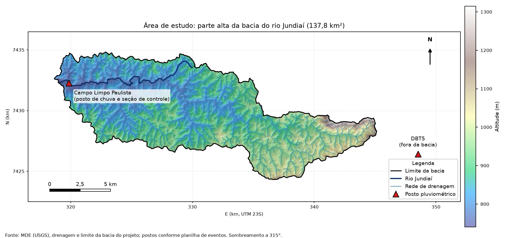
### 3.2 Dados observados
Os dados observados vêm de duas fontes: os dois postos pluviométricos e a seção de controle no exutório. A vazão é registrada pela rede telemétrica do Departamento de Águas e Energia Elétrica (DAEE), integrada ao Sistema de Alerta a Inundações de São Paulo (SAISP), em intervalos de 10 minutos; a turbidez é medida de hora em hora na estação de tratamento de água da SABESP, em amostras de água bruta do rio (MURILLO-BERMÚDEZ; MARTIM, 2022). As séries utilizadas neste trabalho estão em passo horário (Tabela 1).
**Tabela 1.** Dados observados em campo.
| Dado | Origem | Uso |
|---|---|---|
| Chuva horária | 2 postos: Desemboque do Túnel 5 (DBT5, fora da bacia, a leste) e Rio Jundiaí em Campo Limpo Paulista (próximo ao exutório) | Entrada do modelo |
| Vazão horária (Q) | Seção de controle no exutório | Volume e pico observados |
| Vazão de base (Bt) | Separada da série de vazão pela fonte dos dados; método não documentado | Separação do escoamento direto |
| Concentração de sedimentos em suspensão (CSS) | Seção de controle, a partir de turbidez (MURILLO-BERMÚDEZ et al., 2023) | Carga de sedimentos observada |
| Eventos | 17 eventos, de 11/2018 a 02/2020, janelas de 23 a 149 h | Unidade de análise |

**Tabela 2.** Características dos 17 eventos: janela, duração, chuva nos postos (P; DBT5 e Campo Limpo), chuva ponderada (R), intensidade máxima em 60 min (RI), vazão de pico, vazão antes do evento e duração da chuva (T chuva).
{{INCLUDE:tabelas/tab_eventos.md}}

Da série horária obtêm-se, para cada evento, o volume escoado total T_R = Σ Q · 3600 (m³), a vazão de pico Q_pico (m³/s) e a carga de sedimentos observada

> SY_obs = Σ (Q · CSS · 3600 / 10⁶)  (t)

somada sobre as leituras horárias da janela do evento. A carga observada varia de 199 a 3.829 t por evento (média de 1.403 t; soma de 23.846 t).
O volume e a carga medidos incluem a vazão de base. Em todos os 17 eventos, o volume T_R é exatamente a soma das vazões horárias na janela do evento, ou seja, o volume *total* escoado no exutório. A vazão de base (coluna Bt da série) corresponde a 34% a 55% desse volume por evento (47% no conjunto), e o escoamento direto restante soma 15,3 de 28,9 milhões de m³ (Tabela 3). O SCS-CN, por definição, calcula só o escoamento direto. Do mesmo modo, SY_obs é a carga total, que inclui o sedimento transportado pela vazão de base. Essas definições condicionam todo o desenho do modelo (seção 4.5).
**Tabela 3.** Volume total, vazão de base e escoamento direto medidos; escoamento direto calculado pelo SCS-CN; sedimento medido.
{{INCLUDE:tabelas/tab_volumes.md}}

**[PENDENTE: decidir se mantém este parágrafo, que contradiz a afirmação “método não documentado” da seção 2.4 e da Tabela 1.]** Ao reproduzir a coluna Bt da série, verificou-se que ela coincide com o filtro digital recursivo de Eckhardt (2005) com coeficiente de recessão a = 0,995 e índice máximo de vazão de base BFImax = 0,698, os mesmos em todos os eventos; rodando o filtro sobre toda a série horária, a diferença para Bt tem mediana de 0,0002 m³/s e máximo de 0,004 m³/s, ou seja, a série é reproduzida praticamente por inteiro. A cada hora o filtro calcula a vazão de base a partir da vazão de base da hora anterior e da vazão observada:

> b(t) = [ (1 − BFImax) · a · b(t − 1) + (1 − a) · BFImax · Q(t) ] / (1 − a · BFImax),  com b(t) ≤ Q(t)

O resultado depende dos parâmetros: com a = 0,995 e BFImax de 0,5 a 0,8, o escoamento direto corresponde a 64% a 45% do volume total (53% com 0,698); com a = 0,98 e BFImax = 0,698, a 38%; o filtro de Lyne e Hollick (α = 0,925; três passadas) dá 47%, e uma linha reta na vazão inicial, 75%. O nível do escoamento direto depende, portanto, do método e dos parâmetros, mas o padrão entre eventos, não (correlação de 0,996 entre Bt e o filtro de Lyne e Hollick). [PENDENTE: confirmar com os autores dos dados a origem dos parâmetros a = 0,995 e BFImax = 0,698.]
### 3.3 Dados cartográficos
Os mapas temáticos de solo e de uso, do Plano de Bacias (CONSÓRCIO PROFILL-RHAMA, 2020), foram usados para espacializar os fatores K e C, com os valores por classe adotados na Iniciação Científica anterior (VIVARELLI et al., 2025); o modelo digital de elevação forneceu o relevo e o fator LS; o número de curva veio da base nacional de Curva Número da Agência Nacional de Águas e Saneamento Básico (ANA, 2024), em três condições de umidade antecedente (Tabela 4; Figuras 2 e 3).
**Tabela 4.** Dados cartográficos.
| Fator | Fonte | Valor médio |
|---|---|---|
| K | mapa pedológico (Plano de Bacias 2020), valor de K por classe de solo da IC | 0,039 |
| C | mapa de uso do solo (Plano de Bacias 2020), valor de C por classe de uso da IC | 0,050 |
| LS | MDE de 30 m (USGS), corrigido e com área acumulada no SAGA/QGIS; LS por Moore e Burch (1986), com rampa limitada a 200 m | 7,80 |
| P | constante | 1,0 |
| CN | base nacional de CN da ANA (BR_CN-2022, 30 m), em 3 condições de umidade antecedente | 71,6 (AMC II) |

**Tabela 5.** Valores de K por classe de solo e de C por classe de uso, e participação de cada classe nos pixels de cálculo.
{{INCLUDE:tabelas/tab_fatores_classes.md}}

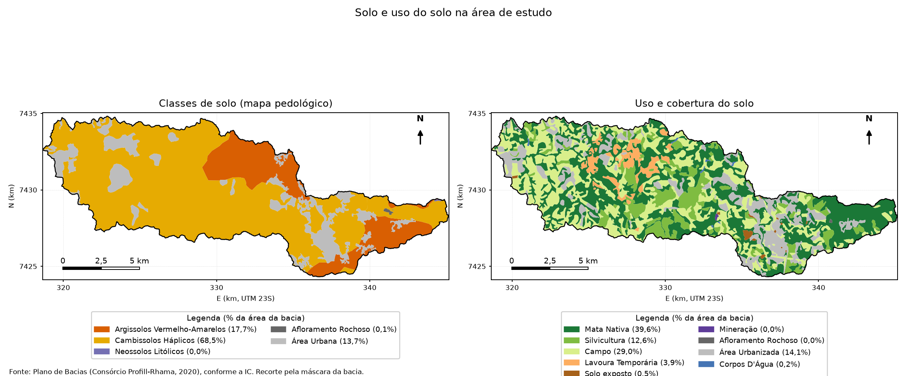
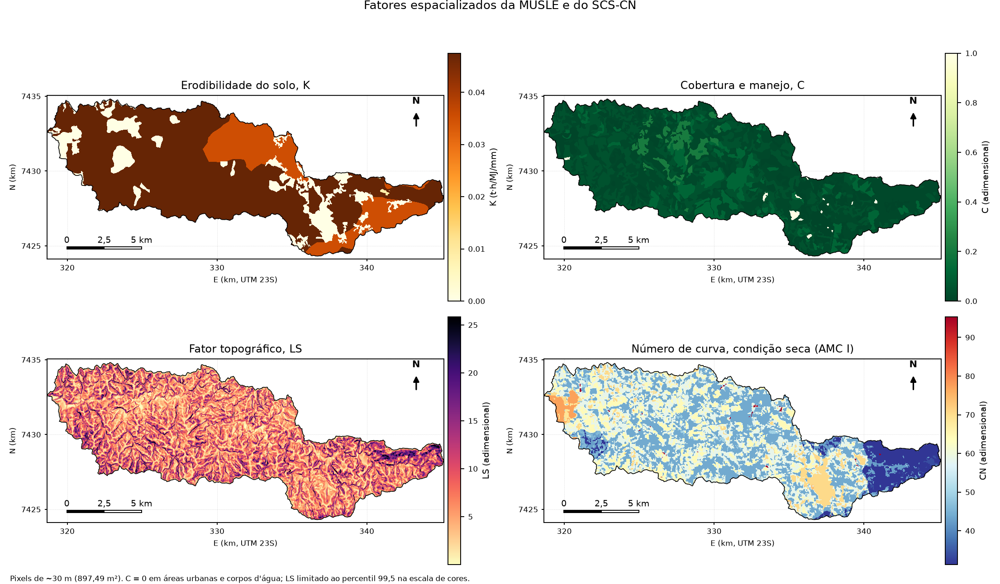
Todos os rasters usam a mesma grade de 884 × 365 pixels de ~30 m (29,992 × 29,925 m; área do pixel de 897,49 m²), em SIRGAS 2000 / UTM 23S. Cerca de 154,7 mil pixels têm número de curva e 153,9 mil têm todos os fatores (K, C, LS e CN), o que corresponde a 138,1 km²; a diferença de cerca de 810 pixels vem de bordas em que os mapas de solo, uso e relevo não coincidem, e esses pixels ficam de fora do cálculo da erosão. Nas áreas urbanizadas e nos corpos d'água, o fator C é zero, e nas áreas sem classe de solo (urbanas), K é zero: esses pixels têm erosão nula no modelo.
Os valores de CN não foram calculados neste trabalho: vêm da base nacional de Curva Número da ANA (ANA, 2024), no recorte do raster BR_CN-2022, de 30 m, reprojetado para SIRGAS 2000 / UTM 23S. Essa base combina o uso e a cobertura da terra do MapBiomas (coleção de 2023, referente ao ano de 2022) com o mapa pedológico do IBGE, classificando os solos em grupos hidrológicos conforme Sartori, Lombardi Neto e Genovez (2005). Na área de estudo, o raster da condição de umidade média (AMC II) assume 20 valores entre 52 e 98, com média de 71,6 nos pixels de cálculo; os rasters das condições seca e úmida reproduzem exatamente as conversões empíricas de Chow, Maidment e Mays (1988) aplicadas a esse raster, com médias de 52,5 (AMC I) e 84,9 (AMC III). Por essa procedência, o número de curva e os fatores K e C derivam de mapas de uso distintos — MapBiomas, referente a 2022, e Plano de Bacias, de 2020.
## 4. METODOLOGIA
### 4.1 Visão geral
O trabalho estima, para cada um dos 17 eventos, quanta erosão cada pixel da bacia produz e quanto sedimento chega ao exutório, e compara o resultado com o sedimento medido. A Figura 4 resume o fluxo. Para cada evento:
- a chuva medida nos dois postos é interpolada para todos os pixels (seção 4.2.4);
- o método SCS-CN converte a chuva de cada pixel em escoamento direto, segundo o número de curva do pixel (seção 4.3);
- a vazão de pico local do pixel e a erosão local são calculadas pela fórmula de Williams, aplicada pixel a pixel (seção 4.4);
- a erosão dos pixels é somada, e o sedimento do evento é escrito como a soma de dois termos: o das encostas (soma dos pixels) e o da vazão de base (da bacia) (seção 4.5);
- os dois parâmetros de escala do modelo são calibrados contra o sedimento medido no exutório, em escala logarítmica (seção 4.6);
- o desempenho é avaliado por validação cruzada *leave-one-out* aninhada, com métricas pouco sensíveis ao evento dominante (seções 4.7 e 4.8);
- o modelo é comparado com testes simples, que usam os mesmos dados sem a fórmula de erosão, e com a formulação concentrada da Iniciação Científica (seções 4.9 e 4.10).
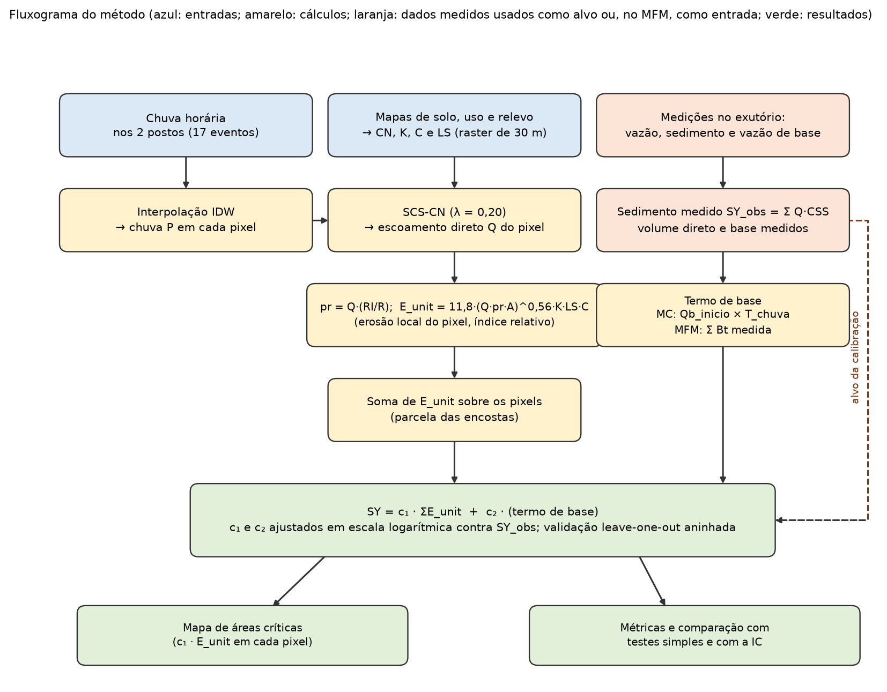
O modelo foi aplicado de duas formas, que diferem apenas na origem da água de cada evento: o **Modelo Calculado (MC)**, em que o escoamento vem da chuva pelo SCS-CN (uma previsão), e o **Modelo Forçado ao Medido (MFM)**, em que o volume de escoamento direto e a vazão de base são os medidos (uma referência que indica o desempenho possível com uma boa estimativa da água).
### 4.2 Preparação dos dados
#### 4.2.1 Variáveis de cada evento e pixels de cálculo
**Tabela 6.** Variáveis usadas e seu cálculo.
| Símbolo | Significado | Unidade | Origem ou cálculo |
|---|---|---|---|
| P₁, P₂ | chuva total do evento nos postos DBT5 e Campo Limpo | mm | soma da chuva horária na janela do evento |
| R | lâmina de chuva do evento | mm | R = w₁·P₁ + (1 − w₁)·P₂, com w₁ = 0,307 (mínimos quadrados nos 17 eventos) |
| RI | intensidade máxima de chuva em 60 min | mm/h | maior valor entre os dois postos |
| T_chuva | duração da chuva | h | maior valor entre os dois postos |
| T_R | volume total escoado no exutório | m³ | Σ Q · 3600 sobre a janela do evento |
| V_base | volume da vazão de base | m³ | Σ Bt · 3600 (Bt: vazão de base do filtro de Eckhardt) |
| V_dir | volume de escoamento direto | m³ | T_R − V_base |
| Qb_inicio | vazão no início do evento | m³/s | primeiro valor de Bt da janela |
| Q_pico | vazão de pico | m³/s | maior vazão horária da janela |
| SY_obs | carga de sedimentos medida (total) | t | Σ Q · CSS · 3600 / 10⁶ |

A carga SY_obs usa a concentração CSS em mg/L (equivalente a g/m³): a vazão (m³/s) multiplicada por 3.600 s dá o volume de cada hora, que multiplicado pela concentração dá gramas, convertidos em toneladas pela divisão por 10⁶.

Todos os dados espaciais foram colocados na mesma grade, a do raster de chuva (884 × 365 pixels, SIRGAS 2000 / UTM 23S, pixel de 29,992 × 29,925 m = 897,49 m²). O raster de número de curva, que tinha outra grade (973 × 362), foi reamostrado pelo vizinho mais próximo, isto é, cada pixel da grade de cálculo recebe o valor do pixel do raster original que contém o seu centro. O cálculo da erosão só é feito nos pixels em que existem, ao mesmo tempo, número de curva, K, C e LS (153.855 pixels, 138,1 km²); os demais ficam sem valor.
#### 4.2.2 Fatores K, C, LS e P
Os fatores K e C foram atribuídos por classe (Tabela 5): cada pixel recebe o valor da classe de solo ou de uso do polígono que contém o seu centro. Essa regra reproduz exatamente os rasters de K e de C usados no trabalho (verificado pixel a pixel). O fator LS foi calculado a partir do modelo digital de elevação, pela formulação de área de contribuição de Moore e Burch (1986):

> LS = (A_s / 22,13)^0,4 · (sen β / 0,0896)^1,3

em que A_s é a área de contribuição específica do pixel (área acumulada a montante dividida pela largura da célula, em m) e β é a declividade local. O cálculo foi feito sobre o MDE reprojetado para SIRGAS 2000 / UTM 23S (pixel em metros), com a área acumulada da rede de drenagem corrigida (seção 3.1). Como a USLE descreve erosão de encosta, e não de canal, A_s foi limitada a 200 m, o maior comprimento de rampa admitido pela equação: sem esse limite, A_s chega a milhões de metros nos pixels de canal, onde a bacia inteira drena por uma célula, e o LS perde sentido físico. O LS resultante tem média de 7,80 e cresce de 0,14, no terreno plano, a cerca de 25, nas encostas mais íngremes, com correlação de 0,94 com a declividade. O fator P é igual a 1,0 em toda a bacia, porque não há práticas conservacionistas ativas.
#### 4.2.3 Número de curva e retenção S
O número de curva CN (de 0 a 100) mede quanto um pixel tende a gerar escoamento: valores altos, como os de áreas urbanizadas, indicam pouca infiltração; valores baixos, como os de mata, indicam muita infiltração. O CN foi obtido do cruzamento do uso com o solo, para a condição de umidade média (AMC II), e convertido para a condição seca (AMC I) por

> CN_I = 4,2 · CN_II / (10 − 0,058 · CN_II)

(CHOW; MAIDMENT; MAYS, 1988; o resultado reproduz o raster usado em menos de 10⁻⁵). O CN médio passa de 71,6 (AMC II) para 52,5 (AMC I). A retenção potencial máxima S (mm), que é a quantidade de chuva que o solo pode absorver antes de gerar escoamento, é

> S = 25,4 · (1000 / CN_I − 10)

e vale 255,7 mm em média na bacia (de 12 a 558 mm entre os pixels).
#### 4.2.4 Chuva espacializada
Os dois postos medem a chuva em pontos. Para estimar a chuva em cada pixel, usa-se o inverso do quadrado da distância (IDW, potência 2): quanto mais perto de um posto, maior o peso dele.

> P(x) = (P₁/d₁² + P₂/d₂²) / (1/d₁² + 1/d₂²)

em que d₁ e d₂ são as distâncias (m) do centro do pixel aos postos, em coordenadas UTM; os postos foram projetados de latitude e longitude (EPSG:4326) para SIRGAS 2000 / UTM 23S: DBT5 em E 348.520,8 m e N 7.426.415,3 m, e Campo Limpo em E 319.862,4 m e N 7.432.277,5 m. Com apenas dois postos, um deles fora da bacia, o resultado é um gradiente suave entre os pontos, que muda de evento para evento conforme a chuva medida em cada posto. Esse cálculo reproduz o raster de chuva do QGIS com diferença menor que 10⁻⁵ mm.
### 4.3 Escoamento direto por pixel (SCS-CN)
Para cada pixel, o escoamento direto Q (mm) depende da chuva P e da retenção S do pixel:

> Q = (P − λS)² / (P + (1 − λ)S),  para P > λS
> Q = 0,  para P ≤ λS

O termo λS é a abstração inicial, a chuva que o solo absorve antes de qualquer escoamento. Adotou-se λ = 0,20 (valor padrão do método), compatível com o uso do CN tabelado (seção 2.3). O escoamento calculado é só o direto: não inclui a vazão de base. Adotou-se a condição de umidade antecedente seca (AMC I) [PENDENTE: justificar a escolha; com ela, o SCS-CN com λ = 0,20 calcula 88% do escoamento direto medido no conjunto dos 17 eventos (Tabela 3)]. Pixels em que a chuva é menor que λS não geram escoamento; no evento 11, por exemplo, isso acontece em 10% dos pixels.
### 4.4 Vazão de pico local e erosão local
A fórmula de Williams (seção 2.2) usa o volume e a vazão de pico do escoamento. Seguindo Hao et al. (2022), cada pixel tem a sua própria vazão de pico, calculada sem roteamento hidráulico: o escoamento do pixel, em volume por segundo, é ponderado pela concentração temporal da chuva do evento, isto é, pela razão entre a intensidade máxima (RI) e a lâmina total (R):

> pr_k = (Q_k / 1000) · A_pix · (RI / R) / 3600   (m³/s)

Em palavras: Q_k/1000 é a lâmina em metros, multiplicada pela área do pixel A_pix (897,49 m²) dá o volume escoado no pixel (m³); a razão RI/R (por hora) indica a fração da chuva que cai na hora mais intensa; a divisão por 3.600 converte horas em segundos. Eventos em que a chuva se concentra em poucas horas (RI/R alto) têm picos locais maiores. Essa razão é um número único por evento; a variação de pr entre pixels vem só de Q_k.
A erosão local é a fórmula de Williams aplicada ao pixel, com os coeficientes originais:

> E_unit,k = 11,8 · (Q_k · pr_k · A_pix)^0,56 · K_k · LS_k · C_k · P_k

com Q em mm, pr em m³/s e A_pix em m², como em Hao et al. (2022). Como pr é proporcional a Q, E_unit é proporcional a Q^1,12. E_unit é um índice relativo de erosão, não uma massa em toneladas: os coeficientes de Williams foram ajustados em escala de bacia, e o produto Q · pr · A em um pixel de 897 m² está fora da faixa para a qual eles foram ajustados. O fator c₁ da seção seguinte converte esse índice em toneladas.
### 4.5 Sedimento do evento: modelo de dois componentes
O sedimento medido no exutório inclui o transportado pela vazão de base, que o SCS-CN não representa (seção 3.2). Por isso, o sedimento de cada evento foi escrito como a soma de dois termos:

> SY = c₁ · Σₖ E_unit,k  +  c₂ · (Qb_inicio · T_chuva · 3600)

O primeiro termo é a erosão das encostas: a soma de E_unit sobre todos os pixels de cálculo, com Q igual ao escoamento direto, multiplicada por c₁. O segundo termo representa a contribuição da vazão de base: o volume de referência Qb_inicio · T_chuva · 3600 (m³), em que Qb_inicio (m³/s) é a vazão de base no início do evento (primeiro valor de Bt na janela) e T_chuva (h) é a duração da chuva; ou seja, é o volume que o rio escoaria se mantivesse a vazão que já tinha no início do evento durante todo o tempo de chuva. Esse volume é multiplicado por c₂. A base é um termo único da bacia, não é distribuída pelos pixels. A duração usada é a da chuva e não a do hidrograma, porque a duração do hidrograma só é conhecida depois que ele passa e acompanha o volume observado, o que antecipava o resultado. Os parâmetros c₁ e c₂ (não negativos) convertem cada termo em toneladas; c₁ absorve também a diferença de escala entre o coeficiente de Williams e o pixel e não deve ser lido como razão de entrega de sedimentos. O mapa de áreas críticas mostra somente a parcela das encostas (c₁ · E_unit,k).
As duas versões do modelo diferem na origem da água (Tabela 7):
- **Modelo Calculado (MC):** o escoamento direto Q vem do SCS-CN, aplicado à chuva interpolada, e o termo de base usa o volume de referência Qb_inicio · T_chuva · 3600. Só usa a chuva dos postos, a vazão inicial e a duração da chuva. É uma previsão.
- **Modelo Forçado ao Medido (MFM):** o volume de escoamento direto é forçado ao valor medido, V_dir. O SCS-CN apenas distribui esse volume no espaço: todos os pixels são multiplicados pelo mesmo fator f = V_dir / V_SCS, em que V_SCS é o volume que o SCS-CN calcularia, e o escoamento do pixel é limitado, por cima, à chuva do pixel, Q = min(f · Q_SCS, P), porque o escoamento não pode superar a chuva (esse limite atua em poucos pixels). O termo de base usa a vazão de base medida, V_base = Σ Bt · 3600, em lugar do volume de referência. Não é previsão: mostra o desempenho que o modelo atingiria se a água fosse bem estimada.

**Tabela 7.** Origem da água em cada versão do modelo de dois componentes (MC e MFM).

| Versão | Escoamento direto (termo 1) | Vazão de base (termo 2) | É previsão? |
|---|---|---|---|
| Modelo Calculado (MC) | SCS-CN, a partir da chuva | Qb_inicio × T_chuva × 3600 | sim |
| Modelo Forçado ao Medido (MFM) | volume medido, distribuído pelo padrão do SCS-CN | vazão de base medida (Σ Bt × 3600) | não |

### 4.6 Calibração dos parâmetros

Os parâmetros c₁ e c₂ foram ajustados aos 17 sedimentos medidos minimizando o erro em escala logarítmica:

> mínimo de Σₙ [ ln(SY_obs,n) − ln(c₁ · Σ E_unit,n + c₂ · V_ref,n) ]²,  com c₁ ≥ 0 e c₂ ≥ 0

em que V_ref,n é o volume de referência do termo de base. Esse critério pesa os eventos pelo erro relativo e evita que um único evento muito grande (o evento 15 responde por 48,7% da variância linear da carga medida e por 49% do peso na calibração por mínimos quadrados lineares) comande o ajuste. O problema foi resolvido por mínimos quadrados não lineares com limites (algoritmo de região de confiança), a partir de três pontos de partida, e a melhor solução foi mantida. A Tabela 8 reúne os parâmetros fixos e calibrados.

**Tabela 8.** Parâmetros fixos e calibrados dos modelos.

{{INCLUDE:tabelas/tab_parametros.md}}

### 4.7 Validação cruzada aninhada

Parâmetros ajustados aos mesmos dados usados para avaliar o modelo levam a resultados otimistas. Para evitar isso, cada evento foi previsto com parâmetros ajustados **sem ele**: (i) retira-se um evento; (ii) ajustam-se c₁ e c₂ (e, nos modelos de comparação, os parâmetros de cada um) aos 16 eventos restantes; (iii) prevê-se o sedimento do evento retirado; (iv) repete-se para os 17 eventos. As métricas são calculadas sobre as 17 previsões. A validação é **aninhada**: qualquer etapa que dependa de ajuste (inclusive a regressão do volume no nível intermediário do Apêndice C) é refeita dentro de cada rodada. Os resultados "no ajuste" (sem validação cruzada) são reportados à parte e só têm valor diagnóstico.

### 4.8 Métricas de desempenho

As métricas principais não dependem da variância dos dados e, portanto, não são dominadas por um único evento:

- **Erro percentual mediano (MedAPE):** a mediana de |simulado − medido| / medido × 100 sobre os 17 eventos. A mediana evita que erros muito grandes em poucos eventos dominem. Não se usa a média do erro absoluto percentual, porque ela favorece a subestimativa.
- **Fração de eventos dentro de fator 2:** o percentual de eventos em que o simulado está entre 0,5 e 2 vezes o medido.
- **Correlação de Spearman:** correlação entre as posições (ordens) do simulado e do medido; indica se o modelo ordena os eventos corretamente, sem depender da magnitude.

O NSE em escala logarítmica é o NSE calculado sobre ln(SY) em vez de SY. O NSE compara o erro do modelo com a variação dos próprios dados: vale 1 quando o modelo acerta tudo, 0 quando erra tanto quanto errar prevendo sempre a média dos eventos, e é negativo quando erra mais que isso. Na escala original, o erro entra elevado ao quadrado e, por isso, o evento 15 (3.829 t), que sozinho responde por 48,7% da variância, comanda o resultado. Na escala logarítmica, errar por um fator 2 pesa o mesmo em um evento de 200 t e em um de 2.000 t, e o NSE passa a medir o erro relativo. Em compensação, os três menores eventos (6, 12 e 1) respondem por 68% da variância no logaritmo e passam a comandar a métrica. Como nenhuma das duas versões trata todos os eventos por igual, o NSE em escala logarítmica é usado como medida de apoio, junto com o erro percentual mediano, a fração de eventos dentro de fator 2 e a correlação de Spearman. O NSE linear (NASH; SUTCLIFFE, 1970) é apresentado no Apêndice B, com e sem o evento 15.

### 4.9 Testes simples e referências sem MUSLE

Para saber se o modelo espacializado traz ganho de precisão, cada versão foi comparada com um **teste simples** de dois termos que usa os mesmos dados, sem fórmula de erosão e sem dados espaciais: SY = c₁′ · (medida da água do evento) + c₂′ · (termo de base), com c₁′ e c₂′ calibrados do mesmo modo. Para o MC, a medida da água é a lâmina de chuva do evento; para o MFM, é o volume de escoamento direto medido. Os parâmetros c₁′ e c₂′ não são os mesmos c₁ e c₂ do modelo de dois componentes: são outros números, ajustados ao mesmo conjunto. Como referências adicionais, usaram-se SY = c · chuva do evento e SY = c · volume total medido. Duas versões intermediárias do modelo (volume direto previsto por regressão na chuva, N2; volume direto medido com a base estimada, N3) são apresentadas no Apêndice C.

### 4.10 Comparação com a formulação concentrada da IC

A IC (VIVARELLI et al., 2025) usa Y = α · (D · qp)^β · K · LS · C · P, com D = volume escoado e qp = vazão de pico medidos, K = 0,031, LS = 0,536 e C = 0,267 médios, e α e β calibrados nos 17 eventos (publicados: 0,277 e 0,807). O LS médio da IC (0,536) foi calculado sobre o MDE em coordenadas geográficas e difere do LS recalculado neste trabalho (7,80); como na formulação concentrada os fatores entram como um produto constante e α é recalibrado, essa diferença não altera as métricas da IC refeita. Os resultados publicados (erro médio de −4,15% e faixa de −60% a +37%) foram aproximados com `T_R` e `Q_pico` da planilha de eventos (erro médio de +2,6% e faixa de −47% a +62%; a diferença provavelmente vem da fonte de D e qp). Para comparar nas mesmas métricas, α e β foram recalibrados em escala logarítmica (regressão de ln(SY/(K·LS·C)) sobre ln(D·qp)) e avaliados por *leave-one-out*.

### 4.11 Exemplo numérico: o evento 11

Para acompanhar o cálculo, a Tabela 9 e a Figura 5 mostram o evento 11 (04 a 08/07/2019) do início ao fim, com um pixel de exemplo, escolhido entre os de lavoura temporária sobre Argissolo, com erosão alta (E 330,18 km; N 7.432,86 km).

**Tabela 9.** O evento 11 passo a passo.

| Etapa | Grandeza | Valor |
|---|---|---|
| Chuva medida | DBT5 / Campo Limpo | 62,8 mm / 79,0 mm |
| | lâmina do evento R = 0,307 · 62,8 + 0,693 · 79,0 | 74,0 mm |
| | intensidade máxima RI; razão RI/R | 11,8 mm/h; 0,159 por hora |
| Chuva do pixel (IDW) | média nos pixels de cálculo (intervalo no raster) | 73,5 mm (63,2 a 79,0 mm) |
| Retenção | CN-I médio; S médio | 52,5; 255,7 mm |
| Escoamento direto | Q médio dos pixels; pixels sem escoamento | 5,4 mm; 10% |
| | volume calculado pelo SCS-CN / medido | 751 mil m³ / 1.479 mil m³ (razão 0,51) |
| Pixel de exemplo | chuva P; CN-II → CN-I; S | 75,4 mm; 81,0 → 64,2; 141,9 mm |
| | abstração inicial λS; escoamento Q | 28,4 mm; (75,4 − 28,4)² / (75,4 + 0,8 · 141,9) = 11,72 mm |
| | vazão de pico local pr | 11,72/1000 · 897,49 · 0,159 / 3600 = 4,66 · 10⁻⁴ m³/s |
| | K; C; LS | 0,0351; 0,212; 4,869 |
| | índice de erosão E_unit | 11,8 · (11,72 · 4,66 · 10⁻⁴ · 897,49)^0,56 · 0,0351 · 0,212 · 4,869 = 1,039 |
| | sedimento do pixel c₁ · E_unit | 0,00352 · 1,038 = 0,0037 t (3,7 kg) |
| Evento (MC) | soma de E_unit sobre os pixels | 30.003 |
| | termo das encostas c₁ · ΣE | 0,00352 · 30.003 = 106 t |
| | volume de referência da base Qb_inicio · T_chuva · 3600 | 0,945 · 23 · 3.600 = 78.226 m³ |
| | termo de base c₂ · volume | 0,01311 · 78.226 = 1.025 t |
| | sedimento simulado (ajuste); validação cruzada | 1.131 t (−38%); 1.098 t (−40%) |
| Evento (MFM) | sedimento simulado, validação cruzada | 1.711 t (−6%) |
| Medido | SY_obs = Σ Q · CSS | 1.822 t |

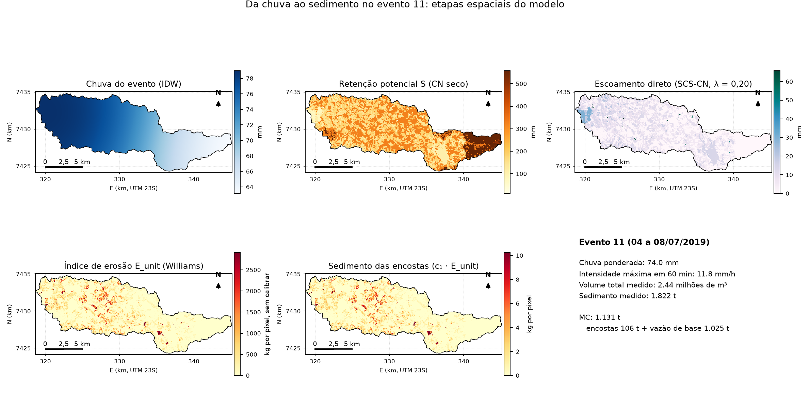

---

## 5. RESULTADOS E DISCUSSÃO

### 5.1 O volume e a carga medidos incluem a vazão de base

Os resultados da seção 3.2 mostram que a comparação direta entre o escoamento calculado pelo SCS-CN e o volume medido é desigual: o modelo calcula apenas o escoamento direto, e o volume medido tem de 34% a 55% de vazão de base (Tabela 3). O resultado mais importante desta fase é, portanto, de definição: qualquer calibração do SCS-CN contra `T_R` ajusta o modelo a uma grandeza que ele não representa.

### 5.2 O SCS-CN não prevê o escoamento direto desta bacia

**Tabela 10.** Volume do SCS-CN (CN-I) contra o escoamento direto observado, por λ.

| λ | Erro médio | Erro absoluto médio | NSE do volume |
|---|---|---|---|
| 0,05 | +92% | 121% | −6,1 |
| 0,14 | +5,9% | 70% | −1,75 |
| 0,20 (padrão, adotado) | −27,5% | 58% | −0,72 |
| 0,28 | −55,1% | 65% | −0,41 |

Para nenhum valor de λ o NSE do volume contra o escoamento direto é positivo. Com λ = 0,20, o volume calculado fica abaixo do medido em 11 dos 17 eventos (razão mediana de 0,59), mas o erro não é uniforme: nos eventos pequenos, de 23 a 36 mm de chuva (eventos 10, 1, 4 e 7), o SCS-CN calcula de 2% a 6% do escoamento medido, e nos grandes (eventos 15 e 9, de 139 e 93 mm), cerca de 2 vezes o medido (Tabela 3). A razão entre o escoamento direto observado e o calculado se correlaciona, em escala logarítmica, com a lâmina de chuva do evento (r = −0,89; em escala linear, −0,63), e pouco com a umidade antecedente (|r| ≤ 0,26 com a vazão inicial e com a chuva dos 5 dias anteriores, sem significância com 17 eventos): a curva chuva-escoamento do SCS-CN, em que o coeficiente de escoamento cresce com a chuva, não descreve esta bacia, em que o coeficiente de escoamento direto medido é aproximadamente constante em relação à chuva e varia de 0,03 a 0,22 entre eventos (r = 0,19 em log com a lâmina). Isso faz o SCS-CN subestimar chuvas pequenas e superestimar as grandes. A chuva, em si, carrega a informação: o logaritmo da lâmina de chuva do evento tem correlação de 0,76 com o do escoamento direto medido, maior que a do volume calculado pelo SCS-CN (0,72), e a chuva interpolada fica dentro de 5% da lâmina de cada evento (razão de 0,95 a 1,03). Trocar o IDW por uma chuva uniforme quase não altera a correlação com o volume medido (de 0,67 para 0,69). Uma regressão log-log do volume direto na chuva do evento tem NSE de 0,47 em validação cruzada, mas erro absoluto de 56%. O problema está, portanto, na conversão de chuva em escoamento, e não na interpolação da chuva. **Recalibrar essa conversão não resolve.** Foram testadas 11 formas calibradas contra o escoamento direto (escala de S e λ livres, S dependente da chuva, forma assintótica de Hawkins, regressões e um coeficiente de escoamento com abstração fixa), sempre com validação cruzada aninhada (Apêndice D). O volume previsto melhora (erro mediano de 69% para 40% a 47%; NSE de −0,69 para 0,4), mas não supera uma regressão simples na chuva, e o sedimento do modelo de dois componentes não muda de forma distinguível (diferença do NSE em log de +0,02 a +0,08, com intervalo de confiança de cerca de −0,15 a +0,35). Como o coeficiente de escoamento varia sete vezes entre eventos por razões que a chuva não explica, nenhuma conversão baseada só na chuva captura essa variação. Quando calibrado livremente, o SCS-CN deixa de ser um SCS-CN: λ vai a zero (limite do intervalo) e o CN equivalente cai para cerca de 51, ou a retenção passa a crescer quase proporcionalmente à chuva, o que equivale a um coeficiente de escoamento constante.

### 5.3 Resultados do Modelo Calculado (MC)

O MC (só chuva e vazão inicial) obteve c₁ = 0,0035 e c₂ = 0,0131 t por m³ de volume de referência (Tabela 8). Na validação cruzada, o erro percentual mediano foi de 32,6%, e 71% dos eventos (12 de 17) ficaram dentro de fator 2; o NSE em escala logarítmica foi 0,48 e a correlação de Spearman, 0,72. A Tabela 12 mostra o resultado em cada evento, para o MC, o MFM, a IC refeita e a referência SY = c · chuva. No ajuste, o MC superestima os eventos 1, 9 e 16 (+105%, +178% e +171%) e subestima os eventos 4, 7, 11 e 12 (de −38% a −58%) (Tabela 11).

{{TABELA_B}}

**Tabela 12.** Sedimento medido e simulado em cada evento (t), com validação *leave-one-out*, e erro percentual de cada modelo.

{{INCLUDE:tabelas/tab_resultados.md}}

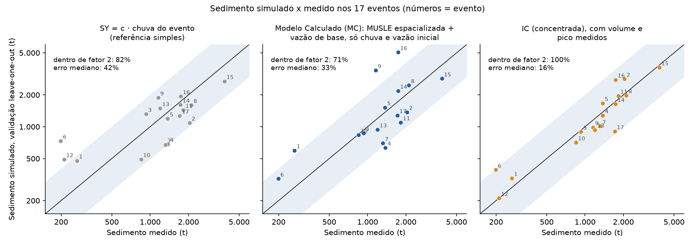

**Nas previsões do MC, a vazão de base carrega a maior parte do sedimento simulado.** Em mediana, as encostas respondem por 9% do sedimento simulado (máximo de 35%) e o termo de base, por 91% (Figura 7). O termo de base (Qb_inicio × T_chuva) funciona como indicador do tamanho e da duração do evento; ele não deve ser lido como processo físico isolado. Esse resultado, e não o desempenho agregado, é o que justifica dizer que, sem volume de escoamento medido, a parte espacial do modelo pouco contribui para a previsão.

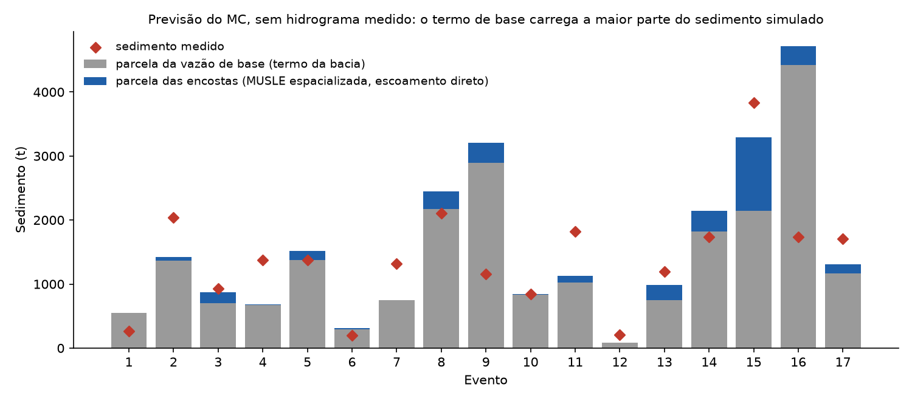

### 5.4 O gargalo: transformar chuva em escoamento

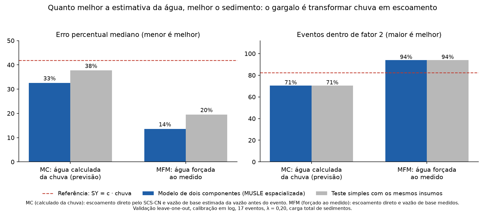

{{TABELA_ESCADA}}

Forçando a água ao valor medido, a fração de eventos dentro de fator 2 sobe de 71% para 94%, o erro mediano cai de 32,6% para 13,6% e a parcela das encostas no sedimento simulado passa de 9% para 38% (mediana). O que muda entre as duas versões é só a água; a fórmula de erosão, os fatores do solo, do uso e do relevo e o desenho em dois componentes são os mesmos. A qualidade do sedimento estimado depende, portanto, da qualidade da estimativa do escoamento, e a fórmula de erosão e o desenho em dois componentes não são o limite. O erro mediano de 14% exige, porém, que **tanto a água das encostas quanto a vazão de base** sejam as medidas. As versões intermediárias (Apêndice C) mostram o efeito de cada parte: prever o volume direto por uma regressão simples na chuva (erro de 56% no volume) não melhora o resultado, e medir só o escoamento direto, com a base estimada, leva a 94% dos eventos dentro de fator 2, mas com erro mediano de 34% (NSE em log de 0,69). A diferença entre o MFM e o MC, no limite da significância (fração dentro de fator 2: +24 pontos percentuais, intervalo de 95% de 0 a +53), mostra um potencial real, mas que não está firmemente estabelecido com 17 eventos.

### 5.5 O modelo de dois componentes e os testes simples

Com os mesmos insumos, o modelo de dois componentes e o teste simples são equivalentes (Tabela 13). Na versão MC, o erro mediano do modelo (33%) é próximo ao do simples (38%) e a fração dentro de fator 2 é igual (71%); na versão MFM, o modelo é um pouco melhor (14% contra 20%), com 94% em ambos. Em nenhuma das versões a diferença é distinguível do ruído: os intervalos de confiança da diferença mediana do erro por evento incluem zero ([−3,7; +11,6] e [−11,7; +6,6] pontos). A espacialização **não perde precisão** em relação a modelos simples com os mesmos insumos, mas também **não ganha** precisão: o que ela entrega a mais é o mapa. O MC também não supera a referência mais simples: SY = c · chuva do evento tem erro mediano de 41,9% e 82% dos eventos dentro de fator 2 (a diferença com o MC, 33% e 71%, não é distinguível do ruído).

### 5.6 Comparação com a IC

**Tabela 14.** Desempenho na validação cruzada (calibração em escala logarítmica; carga total de sedimentos).

| Modelo | Informação medida usada | Erro mediano | Dentro de fator 2 | NSE em log | Spearman |
|---|---|---|---|---|---|
| SY = c · chuva do evento | chuva | 41,9% | 82% | 0,53 | 0,63 |
| SY = c · volume total medido | volume total | 17,6% | 94% | 0,86 | 0,88 |
| Previsão pura anterior (λ = 0,05, sem base) | chuva | 62,6% | 53% | −0,06 | 0,55 |
| MUSLE só com escoamento direto do SCS-CN (λ = 0,20) | chuva | 97,9% | 24% | −3,95 | 0,57 |
| **MC** | chuva, vazão inicial | 32,6% | 71% | 0,48 | 0,72 |
| **MFM** | volume direto e vazão de base | 13,6% | 94% | 0,87 | 0,85 |
| **IC refeita (concentrada)** | volume total e pico | 16,3% | 100% | 0,87 | 0,93 |

A formulação concentrada da IC, com volume e pico medidos do próprio hidrograma, tem desempenho muito bom (100% dos eventos dentro de fator 2 na validação cruzada), semelhante ao do MFM, que recebe informação equivalente. O MC, que só usa a chuva e a vazão inicial, é pior que a IC. A IC, no entanto, não prevê (precisa do hidrograma do evento, que gera também o sedimento medido), não gera mapa e seus coeficientes foram ajustados nos mesmos 17 eventos. Com informação equivalente, a espacialização iguala a qualidade da formulação concentrada e acrescenta o mapa.

### 5.7 Mapas

#### 5.7.1 Da chuva ao sedimento, evento a evento

As Figuras 9 a 11 mostram, para os 17 eventos, a chuva interpolada, o escoamento direto calculado pelo SCS-CN e o sedimento das encostas do MC, com a mesma escala de cores em todos os eventos para permitir a comparação. Na chuva (Figura 9), o gradiente leste-oeste varia entre eventos conforme o que cada posto registrou: a chuva é maior a oeste (posto de Campo Limpo) em 13 dos 17 eventos e maior a leste (posto DBT5) nos eventos 1, 2, 4 e 17; no evento 12, o DBT5 não registrou chuva, e no 17 os dois postos medem valores próximos. O escoamento direto (Figura 10) acompanha a lâmina de chuva do evento: é quase nulo nos eventos menores (1, 4, 6, 7, 10 e 12) e alto no evento 15, o maior, em que quase toda a porção oeste e central da bacia gera escoamento; o extremo oeste, próximo ao exutório, tem sempre os maiores valores, onde o número de curva é mais alto (Figura 3). O sedimento das encostas (Figura 11) tem sempre os mesmos pontos de maior contribuição, que mudam de intensidade de um evento para outro, mas não de lugar, porque o padrão espacial é dominado pelos fatores fixos (K, C e LS), enquanto a chuva e o escoamento definem a intensidade geral do evento.

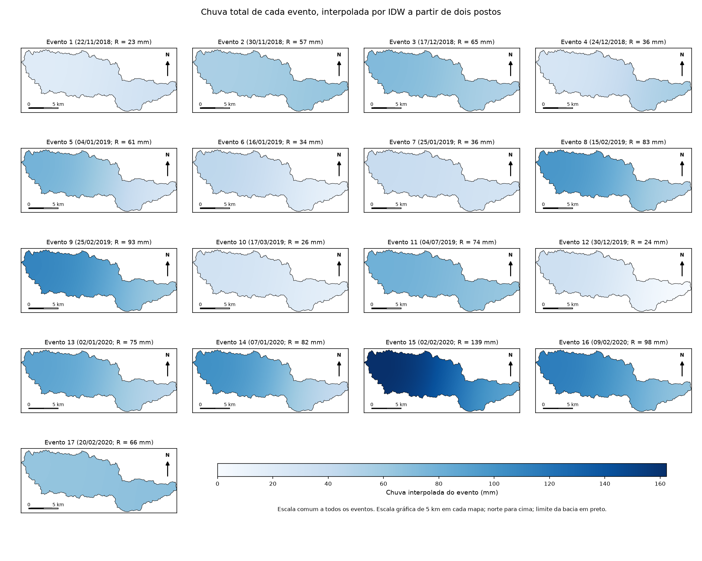

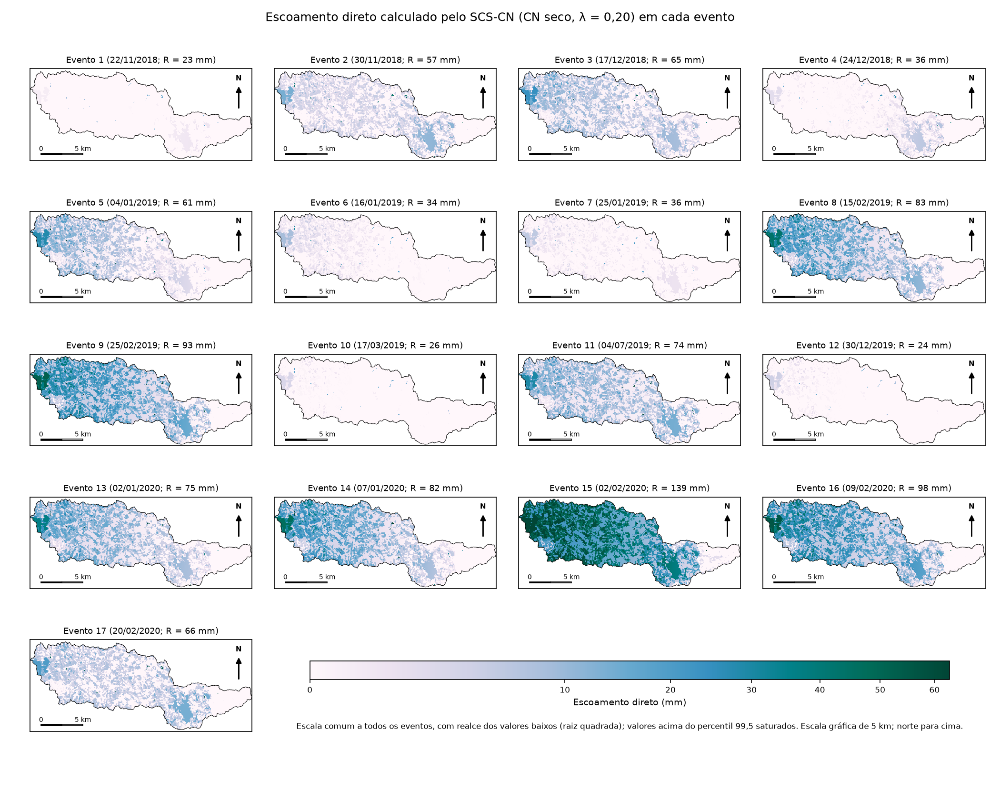

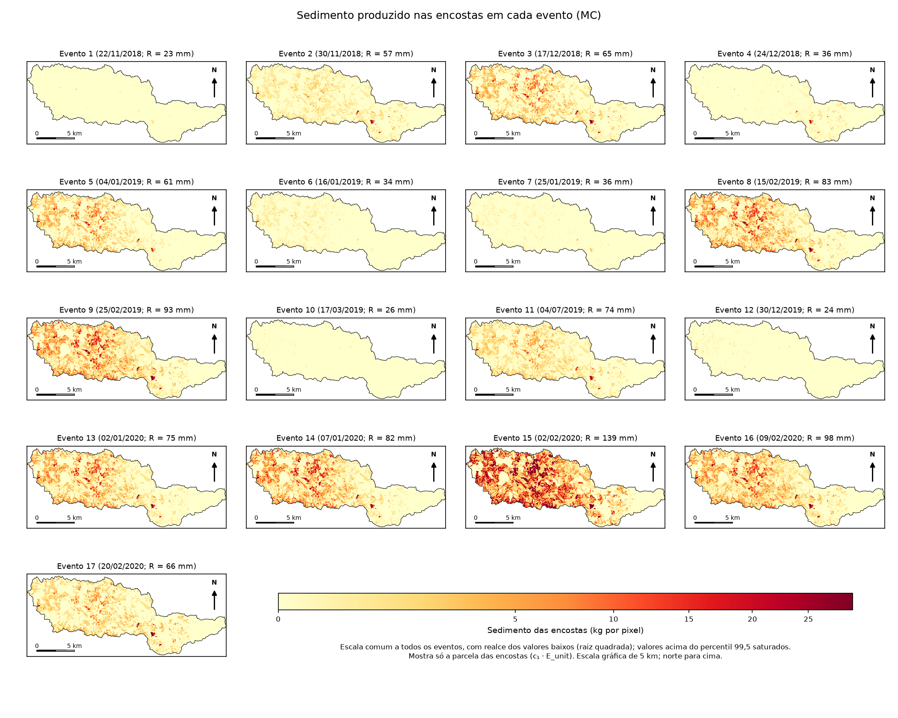

#### 5.7.2 Sedimento médio e áreas críticas

A Figura 12 mostra o sedimento médio dos 17 eventos e as áreas críticas, definidas como os 5% de pixels de maior contribuição, para o MC e para o MFM. Os dois mapas são muito parecidos (correlação de 0,97; 90,9% das áreas críticas coincidem), o que indica que o padrão espacial não depende da forma de estimar a água. A correlação do mapa com o produto K · LS · C é de 0,69 (Spearman de 0,79), o que indica que o padrão espacial carrega também informação da chuva e do escoamento (CN), e não só dos fatores fixos.

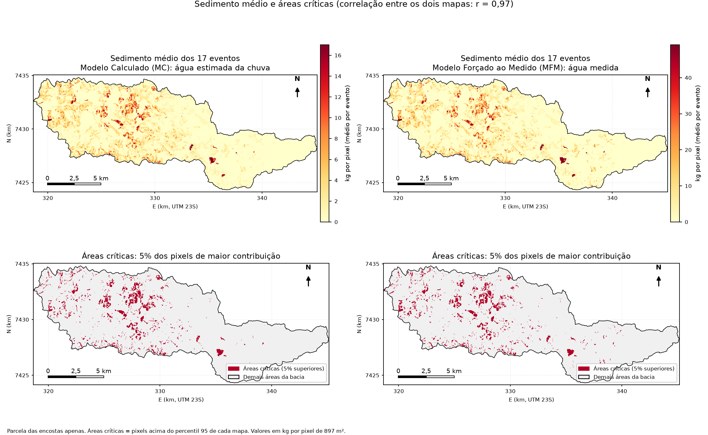

As áreas críticas se concentram em poucas manchas na porção central e oeste da bacia e em algumas manchas pequenas ao sul. A Tabela 15 mostra que a contribuição é muito desigual entre os usos do solo: a lavoura temporária ocupa 3,9% da área e responde por cerca de 23% do sedimento (21% no MFM); o solo exposto ocupa 0,5% e responde por 9% (13% no MFM); o campo ocupa 29,0% e responde por 39% (40%); a mata nativa ocupa 39,6% e responde por 6% (5%); as áreas urbanizadas, que têm erosão nula no modelo (C = 0), ocupam 14,1%. Em relação aos solos (Tabela 16), 94% do sedimento vem dos Cambissolos, que têm o maior K (0,0475) e ocupam 68,6% da área. Esses resultados dependem dos valores de K e C por classe adotados e não foram validados no espaço, porque só há medição de sedimento no exutório; devem ser lidos como contribuições relativas.

**Tabela 15.** Contribuição de cada classe de uso para o sedimento médio das encostas (MC e MFM).

{{INCLUDE:tabelas/tab_classes_uso.md}}

**Tabela 16.** Contribuição de cada classe de solo para o sedimento médio das encostas.

{{INCLUDE:tabelas/tab_classes_solo.md}}

A coincidência dos mapas entre o MC e o MFM não constitui validação independente: os dois distribuem a água pelo mesmo padrão do SCS-CN e usam os mesmos K, C e LS.

---

## 6. LIMITAÇÕES

a) **Só o MC é previsão.** O MFM usa a água do próprio evento (volume direto e vazão de base medidos). O desempenho dele (94% dos eventos em fator 2; erro mediano de 14%) é o que o modelo atingiria com uma boa estimativa do escoamento; não é o desempenho do modelo como ferramenta de previsão.
b) **A parte espacial do modelo contribui pouco para a previsão sem volume medido** (9% do sedimento simulado em mediana no MC) e não supera uma regra simples com a chuva do evento.
c) **Dados escassos:** 17 eventos, com um deles (o evento 15, de 139 mm) respondendo por 48,7% da variância linear da carga. As métricas foram escolhidas para reduzir esse peso, mas os intervalos de confiança são largos (por exemplo, o NSE em log do modelo de dois componentes tem intervalo de 95% de −0,75 a 0,83 por bootstrap dos eventos). O evento 1B, que existe na planilha de eventos, não entrou na análise [PENDENTE: justificar o critério de exclusão ou incluí-lo].
d) **Chuva de apenas dois postos**, um deles fora da bacia; o padrão espacial da chuva é um gradiente suave entre dois pontos.
e) **Sem validação espacial:** só há medição de sedimento no exutório.
f) **Vazão de base e carga total.** A vazão de base foi fornecida com os dados, sem método de separação documentado [PENDENTE: se a seção 3.2 mantiver a identificação do filtro de Eckhardt, citar aqui os parâmetros a = 0,995 e BFImax = 0,698]. O nível do escoamento direto condiciona o resultado: ele varia de 45% a 64% do volume total conforme o BFImax e de 38% a 75% conforme o método de separação. A carga medida inclui o sedimento da vazão de base, e o termo de base do modelo é empírico.
g) **E_unit é um índice relativo**, não tonelagem por pixel; c₁ absorve a escala e a entrega de sedimentos.
h) **RI e R:** RI é o máximo entre os dois postos e R é a lâmina ponderada, de modo que RI/R passa de 1/h nos eventos 1 e 12 (fisicamente impossível para um posto só).
i) **λ e CN:** λ = 0,20 foi fixado antes de avaliar o desempenho, mas depois de uma etapa exploratória com vários valores. O CN vem da base nacional da ANA (MapBiomas de 2022 e mapa de solos do IBGE), referente a um ano diferente do uso do solo do Plano de Bacias (2020) que define K e C; os 17 eventos são de 2018 a 2020.
j) **Duração da chuva** é conhecida só ao final da chuva; para uma previsão em tempo real seria preciso outra variável.
k) **A parcela das encostas depende de hipóteses:** ela vai de 9% a 40% do sedimento simulado conforme a conversão chuva-escoamento adotada e de 62% a 84% com a água medida, conforme o padrão espacial (λ); não é uma estimativa robusta.
l) **Seleção de modelos com poucos dados:** foram testadas 11 formas de conversão chuva-escoamento sobre os mesmos 17 eventos; o otimismo de seleção (cerca de 0,03 no NSE em log) é do tamanho do ganho sobre a referência trivial.

---

## 7. CONCLUSÕES

1. O volume escoado `T_R` e a carga de sedimentos `SY_obs` medidos no exutório incluem a vazão de base (34% a 55% do volume). O escoamento direto calculado pelo SCS-CN não é comparável a eles sem uma separação ou um termo de base.
2. O SCS-CN com λ = 0,20 não prevê o escoamento direto desta bacia (NSE do volume negativo para qualquer λ testado); o erro vem sobretudo da forma da curva chuva-escoamento (o coeficiente de escoamento medido é aproximadamente independente da chuva), e não da umidade antecedente. Recalibrar a conversão melhora o volume, mas não o sedimento.
3. O modelo de dois componentes (encostas e vazão de base) é fisicamente coerente, mas, só com chuva e vazão inicial, tem desempenho equivalente ao de uma regra simples com a chuva do evento (erro mediano de 33%; 71% dos eventos dentro de fator 2).
4. O gargalo está em transformar chuva em escoamento: com a água forçada ao valor medido (escoamento direto e vazão de base), 94% dos eventos ficam dentro de fator 2 e o erro mediano cai a 14%.
5. A espacialização não perde precisão em relação a modelos simples com os mesmos insumos, nem à formulação concentrada da IC quando recebe informação equivalente, e acrescenta o mapa de áreas críticas.
6. Trabalhos futuros: entender por que o coeficiente de escoamento direto varia sete vezes entre eventos (por exemplo, com variáveis de umidade e de estado da bacia que a chuva não traz), mais postos pluviométricos, validação espacial do mapa e a simulação de cenários de conservação, que foi retirada do escopo.

---

---

## REFERÊNCIAS

AGÊNCIA NACIONAL DE ÁGUAS E SANEAMENTO BÁSICO (Brasil). **Curva Número na Base Ottocodificada (1985, 2014 e 2022)**. Brasília: ANA, 2024. Base de dados geoespacial. Disponível em: https://metadados.snirh.gov.br/geonetwork/srv/api/records/d1c36d85-a9d5-4f6a-85f7-71c2dc801a67. Acesso em: 17 out. 2026.

BAERT, P. et al. A regime-based framework for linking runoff initiation and event-scale sediment export in a small temperate agricultural loess catchment. **Catena**, v. 274, art. 110497, 2026. DOI: https://doi.org/10.1016/j.catena.2026.110497.

BRANDÃO, A. R. A. et al. Toward a better understanding of curve number and initial abstraction ratio values from a large sample of watersheds perspective. **Journal of Hydrology**, v. 655, art. 132941, 2025. DOI: https://doi.org/10.1016/j.jhydrol.2025.132941.

CHOW, V. T.; MAIDMENT, D. R.; MAYS, L. W. **Applied hydrology**. New York: McGraw-Hill, 1988.

CONSÓRCIO PROFILL-RHAMA. **Plano de Recursos Hídricos das Bacias Hidrográficas dos Rios Piracicaba, Capivari e Jundiaí, 2020 a 2035**: relatório final. Piracicaba: Comitês PCJ; Fundação Agência das Bacias PCJ, 2020.

ECKHARDT, K. How to construct recursive digital filters for baseflow separation. **Hydrological Processes**, v. 19, n. 2, p. 507-515, 2005. DOI: https://doi.org/10.1002/hyp.5675.

HAO, R. et al. Incorporating sediment connectivity index into MUSLE model to explore soil erosion and sediment yield relationships at event scale. **Journal of Hydrology**, v. 614, art. 128579, 2022. DOI: https://doi.org/10.1016/j.jhydrol.2022.128579.

LYNE, V.; HOLLICK, M. Stochastic time-variable rainfall-runoff modelling. In: HYDROLOGY AND WATER RESOURCES SYMPOSIUM, 1979, Perth. **Proceedings** [...]. Barton: Institution of Engineers Australia, 1979. p. 89-93.

MOORE, I. D.; BURCH, G. J. Physical basis of the length-slope factor in the universal soil loss equation. **Soil Science Society of America Journal**, v. 50, n. 5, p. 1294-1298, 1986. DOI: https://doi.org/10.2136/sssaj1986.03615995005000050042x.

MURILLO-BERMÚDEZ, L. F.; MARTIM, A. L. S. S. Avaliação qualitativa do efeito de histereses entre vazão e concentração de sedimentos em suspensão no rio Jundiaí, SP. In: INTERNATIONAL WORKSHOP FOR INNOVATION IN SAFE DRINKING WATER, 1., 2022, Campinas. **Proceedings** [...]. Campinas: Unicamp, 2022. p. 56-60. DOI: https://doi.org/10.20396/iwisdw.n1.2022.4793.

MURILLO-BERMÚDEZ, L. F.; MARTIM, A. L. S. S.; POLETO, C.; FILHO, J. G. D. . Correlation of turbidity and suspended sediment concentration in natural water flow using alternative data of water treatment plant, case of study in the upper Jundiaí river, Brazil. **International Journal of River Basin Management**, v. 21, n. 2, p. 233-241, 2023. DOI: https://doi.org/10.1080/15715124.2021.1961794.

NASH, J. E.; SUTCLIFFE, J. V. River flow forecasting through conceptual models part I: a discussion of principles. **Journal of Hydrology**, v. 10, n. 3, p. 282-290, 1970. DOI: https://doi.org/10.1016/0022-1694(70)90255-6.

SARTORI, A.; LOMBARDI NETO, F.; GENOVEZ, A. M. Classificação hidrológica de solos brasileiros para a estimativa da chuva excedente com o método do Serviço de Conservação do Solo dos Estados Unidos. Parte 1: classificação. **Revista Brasileira de Recursos Hídricos**, v. 10, n. 4, p. 5-18, 2005. DOI: https://doi.org/10.21168/rbrh.v10n4.p5-18.

USDA-SCS – UNITED STATES DEPARTMENT OF AGRICULTURE, SOIL CONSERVATION SERVICE. **National Engineering Handbook, Section 4**: hydrology. Washington, DC: USDA-SCS, 1972.

VALLE JUNIOR, L. C. G.; RODRIGUES, D. B. B.; OLIVEIRA, P. T. S. Initial abstraction ratio and Curve Number estimation using rainfall and runoff data from a tropical watershed. **RBRH**, Porto Alegre, v. 24, e5, 2019. DOI: https://doi.org/10.1590/2318-0331.241920170199.

VIVARELLI, M. G. et al. **Aplicação da equação universal de perda de solo modificada e calibração com dados de campo em uma bacia hidrográfica antropizada**. Artigo (Iniciação Científica) – Universidade Estadual de Campinas, Campinas, 2025.

WILLIAMS, J. R. Sediment-yield prediction with universal equation using runoff energy factor. In: UNITED STATES DEPARTMENT OF AGRICULTURE. **Present and prospective technology for predicting sediment yield and sources**. Washington, DC: USDA-ARS, 1975. p. 244-252. (ARS-S-40).

WISCHMEIER, W. H.; SMITH, D. D. **Predicting rainfall erosion losses**: a guide to conservation planning. Washington, DC: USDA, 1978. (Agriculture Handbook, n. 537).

---

## APÊNDICE A — Conferência detalhada do evento 11

[PENDENTE: pacote `Evento11_Auditoria/` (planilhas com fórmulas, shapefiles e rasters) a ser refeito com o modelo de dois componentes; resumir aqui a cadeia completa para o evento 11 (04–08/07/2019; 74,0 mm; 2,44 milhões de m³; SY_obs de 1.821,75 t; o modelo de dois componentes simula 1.130,9 t, erro de −37,9%, com 106 t das encostas e 1.025 t do termo de base).]

## APÊNDICE B — Métricas lineares (NSE) com e sem o evento 15

**Tabela 17.** NSE linear com calibração em escala logarítmica para todos os modelos (ajuste, validação cruzada e sem o evento 15, com os parâmetros refeitos sem ele).

| Modelo | NSE (ajuste) | NSE (validação cruzada) | NSE sem o evento 15 |
|---|---|---|---|
| SY = c · chuva do evento | 0,62 | 0,58 | 0,41 |
| SY = c · volume total medido | 0,80 | 0,78 | 0,61 |
| Previsão pura anterior (λ = 0,05, sem base) | −0,72 | −1,00 | −1,11 |
| MC | −0,29 | −0,64 | −1,58 |
| MFM | 0,82 | 0,78 | 0,63 |
| IC refeita (concentrada) | 0,82 | 0,77 | 0,65 |

O NSE linear do MC é negativo porque o critério de calibração (erro relativo) não protege os maiores eventos, e eles dominam a métrica: as superestimativas de cerca de 170% a 180% nos eventos 9 e 16 pesam mais no NSE linear que o acerto dos eventos pequenos. Pelo mesmo motivo, a previsão pura anterior, que obtinha NSE de 0,37 (0,28 na validação cruzada) com calibração por mínimos quadrados lineares, passa a −0,72 com calibração em log: a calibração linear subestimava de propósito os eventos pequenos para acertar o maior. Os modelos que usam o volume do evento (MFM, IC e SY = c · volume) mantêm NSE linear positivo.

## APÊNDICE C — Versões intermediárias de informação hidrológica

**Tabela 18.** Versões intermediárias do modelo de dois componentes e do teste simples (validação cruzada; calibração em log; λ = 0,20). N2: volume de escoamento direto previsto por regressão log-log na chuva do evento, distribuído no espaço pelo padrão do SCS-CN, com a base estimada; N3: volume de escoamento direto medido, com a base estimada.

{{TABELA_INTERM}}

O volume previsto por regressão (erro médio de 56%, com a regressão refeita sem o evento avaliado em cada rodada) não melhora o resultado em relação ao MC: o erro mediano do modelo vai de 33% para 39%, e o teste simples fica melhor (33%). Medir só o escoamento direto, com a base estimada (N3), leva a 94% dos eventos dentro de fator 2, mas com erro mediano de 34% para o modelo e de 24% para o teste simples; nesse caso o teste simples é melhor, e a diferença também não é distinguível do ruído ([−4,3; +28,9] pontos).

## APÊNDICE D — Calibração da conversão chuva-escoamento contra o escoamento direto

Foram testadas formas calibradas da conversão chuva-escoamento, para verificar se um número de curva "melhor" resolveria o gargalo: (i) escala da retenção (S′ = a · S) e λ livres; (ii) retenção dependente da lâmina de chuva, S′ = a · S · (P/P₀)^k, e a forma assintótica de Hawkins, com λ = 0,20 e 0,05; (iii) formas empíricas: ln V = b₀ + b₁ ln P e um coeficiente de escoamento com abstração fixa, V = C_r · (P − I_a) · área (resultado: C_r = 0,114 e I_a = 9 mm, que é plausível e transparente). Todas foram calibradas contra o escoamento direto medido por mínimos quadrados em escala logarítmica, com validação cruzada *leave-one-out* aninhada e, para o sedimento, com o modelo de dois componentes (c₁ e c₂ refeitos sem o evento retido).

**Tabela 19.** Conversão chuva-escoamento calibrada: volume de escoamento direto previsto e sedimento do MC (validação cruzada aninhada).

> [PENDENTE: as colunas de volume desta tabela não dependem do fator LS. As colunas de sedimento das linhas "SCS-CN original" e "Teto" (λ = 0,20, água medida e água e base observadas) já foram recalculadas com o LS novo. As linhas (i) a (iii) e a linha "Teto, padrão espacial λ = 0,05" ainda estão com o LS anterior: refazê-las exige rodar de novo as formas (i) a (iii), cujos scripts são do revisor independente e não estão no repositório (ver `Notas Claude/teste_cn_calibrado.md`). As conclusões (a) a (e) não devem mudar, porque o LS entra como fator multiplicativo e a escala é recalibrada.]

| Conversão | Volume: erro mediano | Volume: NSE | Sedimento: erro mediano | Dentro de fator 2 | NSE em log | Parcela das encostas |
|---|---|---|---|---|---|---|
| SCS-CN original (λ = 0,20) | 69% | −0,69 | 32,6% | 71% | 0,48 | 9% |
| (i) a e λ livres (a = 2,68; λ = 0, no limite) | 65% | −0,42 | 26,7% | 71% | 0,56 | 31% |
| (ii) S dependente da chuva, λ = 0,20 | 43% | 0,39 | 37,6% | 71% | 0,53 | 16% |
| (ii) forma de Hawkins, λ = 0,05 | 40% | 0,43 | 38,3% | 71% | 0,52 | 16% |
| (iii) ln V = b₀ + b₁ ln P | 47% | 0,46 | 39,3% | 76% | 0,54 | 38% |
| (iii) V = C_r · (P − I_a) · área | 53% | 0,46 | 40,5% | 76% | 0,54 | 39% |
| Referência: SY = c · chuva | — | — | 41,9% | 82% | 0,53 | — |
| Teto: água medida, padrão espacial λ = 0,20 | 1% | 0,93 | 34,1% | 94% | 0,69 | 62% |
| Teto: água medida, padrão espacial λ = 0,05 | 0% | 1,00 | 19,9% | 94% | 0,82 | 83% |
| Teto: água e vazão de base observadas | — | — | 13,6% | 94% | 0,87 | 38% |

Principais resultados: (a) o volume melhora com a calibração, mas nenhuma forma baseada em CN supera a regressão log-log na chuva (NSE de 0,46); (b) o sedimento do modelo de dois componentes não difere de forma estatisticamente distinguível do modelo original (diferenças do NSE em log de +0,02 a +0,08; teste de Wilcoxon com p entre 0,6 e 0,9); (c) as conversões que melhor preveem o volume dão erro mediano de sedimento pior (37% a 40%) que o modelo original, e a que melhor prevê o sedimento, (i), é a pior das calibradas para o volume, porque o modelo de dois componentes é pouco sensível à escala do volume (E é proporcional a Q^1,12, e c₁ absorve o fator): o ganho de (i) vem de λ = 0 na forma do padrão espacial e não do volume; (d) a seleção da forma por validação cruzada dupla dá NSE em log de 0,53, erro mediano de 26,7% e 71% dos eventos em fator 2, equivalente à referência SY = c · chuva (0,53; 41,9%; 82%); (e) calibrados livremente, os parâmetros perdem plausibilidade física (λ = 0 e CN equivalente de cerca de 51; ou S proporcional à chuva). Com 17 eventos, a resolução dos testes é de cerca de ±0,2 no NSE em log e ±20 pontos no erro mediano.
